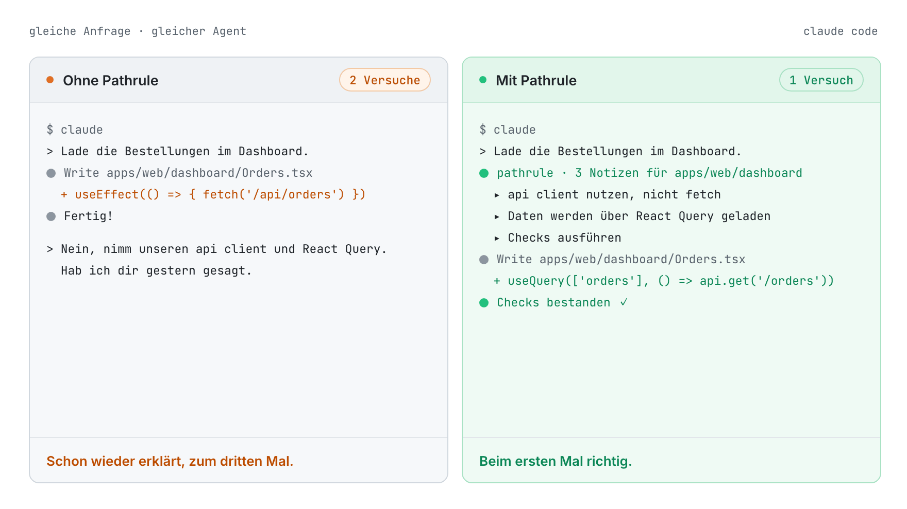
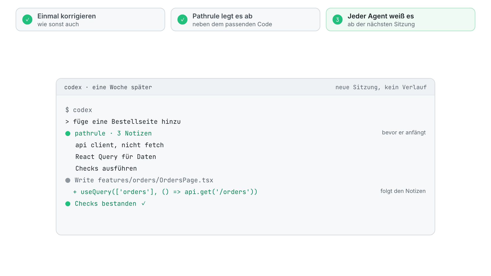
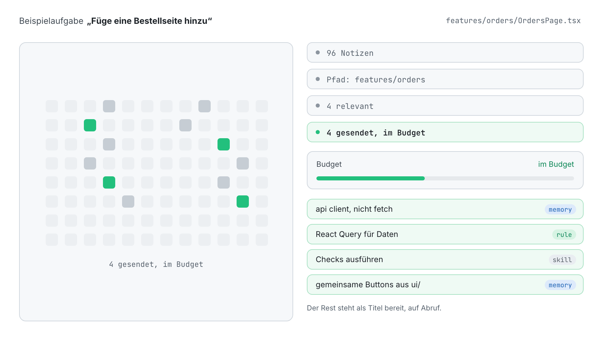
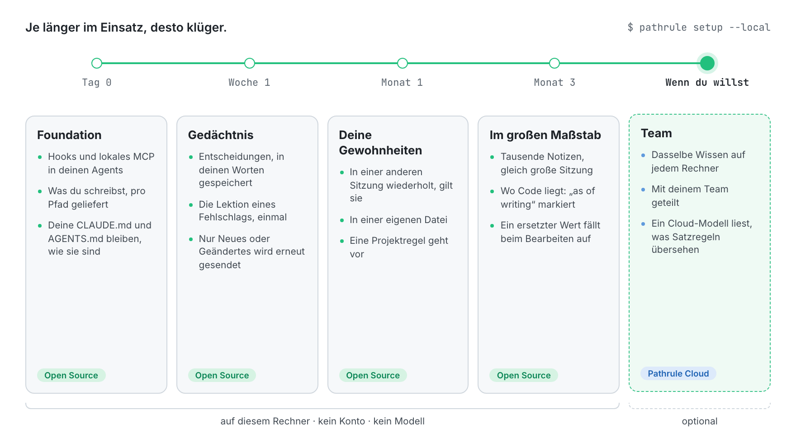
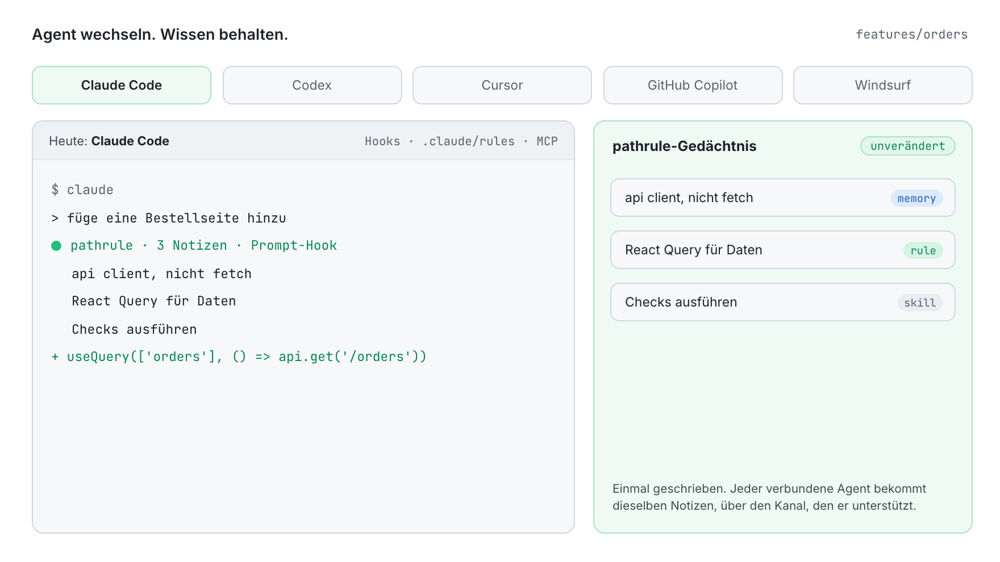

<p align="center">
  <picture>
    <source media="(prefers-color-scheme: dark)" srcset="docs/assets/pathrule-banner-dark.png">
    
  </picture>
</p>

<p align="center">
  <a href="README.md">English</a> · <a href="README.es.md">Español</a> · <a href="README.fr.md">Français</a> · <b>Deutsch</b> · <a href="README.ja.md">日本語</a> · <a href="README.it.md">Italiano</a> · <a href="README.tr.md">Türkçe</a> · <a href="README.pt-BR.md">Português (Brasil)</a>
</p>

<p align="center"><sub>Diese Übersetzung kann hinter dem <a href="README.md">englischen README</a> zurückliegen.</sub></p>

<h3 align="center">Deine KI vergisst. Pathrule erinnert sich.</h3>

<p align="center">
  Die Open-Source-Wissensschicht für Coding-Agents. Pathrule bewahrt, was dein Projekt gelernt hat, als Memories, Regeln und Skills, die an Pfade in deinem Code gebunden sind, und gibt Claude Code, Codex, Cursor, GitHub Copilot und Windsurf nur das, was die aktuelle Aufgabe braucht, bevor sie loslegen.
</p>

<p align="center">
  <a href="https://www.npmjs.com/package/@pathrule/cli"></a>
  <a href="LICENSE"></a>
  <a href="#benchmarks"></a>
  <a href="https://github.com/pathrule/pathrule/actions/workflows/ci.yml"></a>
  <a href="https://marketplace.visualstudio.com/items?itemName=Pathrule.pathrule-vscode"></a>
  <a href="https://open-vsx.org/extension/Pathrule/pathrule-vscode"></a>
</p>

<p align="center">
  <b>PathruleBench, 2000 Einträge:</b> 55 % geringere Kosten pro Kette · 2,7× weniger Input-Tokens · 97 % der Gedächtnisproben bestanden · <a href="#benchmarks">die Zahlen</a>
</p>

<p align="center">
  <a href="https://www.pathrule.io">Website</a> · <a href="https://www.pathrule.io/docs/start/quickstart">Doku</a> · <a href="#quickstart">Schnellstart</a> · <a href="#benchmarks">Benchmarks</a> · <a href="#local-first">Mit der Zeit klüger</a> · <a href="https://www.pathrule.io/changelog">Changelog</a>
</p>

<p align="center">
  <picture>
    <source media="(prefers-color-scheme: dark)" srcset="docs/assets/readme/de/hero-dark.gif">
    
  </picture>
</p>

<p align="center"><sub><i>Gleiche Anfrage, gleicher Agent. Rechts übergibt der Pathrule-Hook die drei Notizen für <code>apps/web/dashboard</code>, bevor der Agent eine Zeile schreibt.</i></sub></p>

<p align="center">
  <b>Funktioniert mit</b>  Claude Code · Codex · Cursor · GitHub Copilot · Windsurf · jeder MCP-Client
</p>

<a id="quickstart"></a>

## Schnellstart

Node.js 22.14.0 oder neuer, auf macOS, Linux oder Windows.

```bash
npm i -g @pathrule/cli
pathrule setup --local    # kein Konto: das Wissen bleibt auf diesem Rechner
pathrule doctor           # zeigt, was jeder Agent bekommt
```

Starte deinen Agent neu. Ab der nächsten Sitzung bekommt er die Notizen für den Pfad, den er gleich anfasst, und schreibt beim Arbeiten neue dazu.

| Weitere Einstiege | Befehl | Gut für |
| --- | --- | --- |
| VS Code-Erweiterung | `code --install-extension Pathrule.pathrule-vscode` | Wissen direkt neben dem Code. Marketplace und Open VSX. |
| Claude Code- / Codex-Plugin | `/plugin marketplace add pathrule/pathrule` · `codex plugin marketplace add pathrule/pathrule` | Installation direkt im Agent. Die Einrichtung zeigt einen Plan, bevor sich etwas ändert. |
| Cursor-Plugin | Cursor Marketplace → Pathrule | Dieselben Hooks, MCP und Skills in Cursor. |
| Gemini CLI- / OpenCode-Plugin | `gemini extensions install https://github.com/pathrule/gemini-cli-extension` · `opencode plugin @pathrule/opencode --global` | Dieselbe Einrichtung in Gemini CLI und OpenCode. |
| Jeder MCP-Client | `npx -y @pathrule/mcp` | Agents ohne Plugin-System. Im offiziellen MCP Registry gelistet. |
| Local Console | `pathrule ui` | Wissen auf 127.0.0.1 durchsuchen und bearbeiten. Kein Konto. |
| Remote MCP | `claude mcp add --transport http pathrule https://cloud.pathrule.io/mcp` | Ausprobieren, ohne etwas zu installieren. Keine Hooks, kein lokaler Modus. |
| Aus dem Quellcode | `pnpm install && pnpm cli:bundle` | An Pathrule mitarbeiten. Siehe [docs/quickstart.md](docs/quickstart.md). |

<a id="explain-once"></a>

## Einmal erklären

Coding-Agents beginnen jede Sitzung bei null. Also kommt dieselbe Korrektur wieder, Tag für Tag, Agent für Agent:

| Tag | Agent | Was du getippt hast |  |
| --- | --- | --- | --- |
| Mo | Claude Code | „nimm unseren api client, nicht fetch“ | 1. |
| Di | Claude Code | „nochmal: api client, nicht fetch“ | 2. |
| Mi | Codex | „wir nutzen den api client.“ | 3. |
| Do | Cursor | „Hab ich dir gestern gesagt. api client.“ | 4. |
| Fr | Claude Code | „API CLIENT. NICHT FETCH.“ | 5. |

Fünf Sitzungen, drei Agents, nichts behalten. Mit Pathrule sagst du es einmal:

<p align="center">
  <picture>
    <source media="(prefers-color-scheme: dark)" srcset="docs/assets/readme/de/explain-once-dark.gif">
    
  </picture>
</p>

1. **Du korrigierst es einmal**, so wie immer.
2. **Pathrule legt es ab**, direkt neben dem Code, um den es geht: eine Memory an `features/`, keine weitere Zeile in einer Datei, die jede Sitzung lesen muss.
3. **Jeder Agent weiß es** ab der nächsten Sitzung, egal welchen du öffnest.

<a id="how-it-works"></a>

## Nur, was zählt

Ein Workspace sammelt Hunderte Notizen. Ein Agent, der `features/orders` bearbeitet, braucht vier davon.

<p align="center">
  <picture>
    <source media="(prefers-color-scheme: dark)" srcset="docs/assets/readme/de/only-what-matters-dark.gif">
    
  </picture>
</p>

Wissen wird nach Pfad, Geltungsbereich und Relevanz ausgewählt und dann in ein Budget pro Prompt eingepasst. Verbindliche Regeln werden nie aus Platzgründen gekürzt. Was nicht passt, wird mit Titel aufgeführt, damit der Agent danach fragen kann. Nennt ein Prompt eine Funktion oder einen Typ, zeigt der Hook dem Agent außerdem Datei und Zeile, wo sie definiert sind (JS/TS, Python, Go).

### Drei Arten von Wissen

| Art | Was sie enthält | Beispiel an `features/` |
| --- | --- | --- |
| **Memory** | Entscheidungen, Stolperfallen und Vorfälle, als kurzes Markdown. | „api client nutzen. Er übernimmt Auth und Retries.“ |
| **Regel** | Vorgaben, an die sich der Agent halten muss, über Ratschlägen eingeordnet. | „Daten werden über React Query geladen.“ |
| **Skill** | Wiederverwendbare Abläufe und Checklisten, die ein Agent ausführen kann. | „Checks ausführen, bevor etwas als fertig gilt.“ |

### Drei Wege hinein

| Kanal | Wann er den Agent erreicht | Kosten |
| --- | --- | --- |
| Pfadbezogene Regeldateien | Claude Code liest beim Sitzungsstart Pathrules eigenen Ordner `.claude/rules/pathrule/`, jede Datei auf ihre Pfade beschränkt. Deine `CLAUDE.md` und `AGENTS.md` bleiben, wie sie sind. | Vom Client zwischengespeichert. |
| Hooks | Bevor der Agent handelt: beim Sitzungsstart, bei jedem Prompt und bei Datei-Tools. Nur neuer oder geänderter Kontext wird erneut gesendet. | Budget pro Prompt. |
| MCP `get_context` | Wenn der Agent fragt, in der Tiefe, die die Anfrage braucht. | In jedem MCP-Client verfügbar. |

<a id="benchmarks"></a>

## Warum nicht einfach CLAUDE.md?

<a href="https://github.com/pathrule/benchmark"></a>

**Eine CLAUDE.md wird bei jedem Schritt ganz gelesen, also macht jede Notiz deines Teams jede Sitzung teurer. Pathrule schickt jedem Prompt nur, was Pfad und Aufgabe brauchen.** PathruleBench hat den Unterschied gemessen: derselbe Agent, dieselben Prompts, dieselben verdeckten Prüfungen, von 500 bis 2000 Einträgen Teamwissen.

<p align="center">
  <picture>
    <source media="(prefers-color-scheme: dark)" srcset="docs/assets/readme/de/bench-cost-tokens-dark.png">
    
  </picture>
</p>

<div align="center">

| Bei 2000 Einträgen Teamwissen | CLAUDE.md | Pathrule |
| :-- | :-: | :-: |
| Kosten einer Kette mit 8 Sitzungen | 3,89–4,21 $ | **1,76–1,89 $** |
| Input-Tokens pro Kette | 11,8–12,5 Mio. | **4,3–4,7 Mio.** |
| Bestandene Gedächtnisproben | 89 % | **97 %** |
| Ketten, die jede Gedächtnisprobe bestanden | 0 von 9 | **5 von 9** |
| Eine einmal genannte Gewohnheit, später befolgt | 78 % | **97 %** |
| Was ein fehlgeschlagener Befehl gelehrt hat, behalten | 33 % | **78 %** |
| Die Arbeit, die jeder Prompt verlangte | 100 % | **100 %** |

</div>

Von 500 auf 2000 Einträge kostet eine Kette mit CLAUDE.md 89 bis 98 % mehr. Mit Pathrule bewegt sie sich zwischen −1 % und +10 %. Deine Wissensbasis darf wachsen, die Rechnung nicht.

<sub>Claude Code mit claude-sonnet-5-5 in Python, Go und TypeScript; neun Ketten pro Arm bei 2000 Einträgen (drei pro Sprache); ausführbare Tests entscheiden über jedes Bestehen, kein Modell bewertet. Der Pathrule-Arm ist die Open-Source-CLI dieses Repositorys im lokalen Modus: ohne Cloud, ohne Modell.</sub>

**[Jede Bedingung, Kette und Prüfung, und wie du es selbst ausführst → pathrule/benchmark](https://github.com/pathrule/benchmark)**

<a id="local-first"></a>

## Je länger im Einsatz, desto klüger.

Der erste Tag braucht weder Konto noch Netzwerk noch Modell. Alles Weitere baut auf dem auf, was du und deine Agents in diesem Repository schon getan habt.

<p align="center">
  <picture>
    <source media="(prefers-color-scheme: dark)" srcset="docs/assets/readme/de/over-time-dark.gif">
    
  </picture>
</p>

| Wann | Was Pathrule tut | Wo es läuft |
| --- | --- | --- |
| **Tag 0**<br>Foundation | Hooks und der lokale MCP-Server werden mit deinen Agents verbunden. Was du schreibst, wird pro Pfad innerhalb eines Budgets geliefert, über die Hooks und die pfadbezogenen Regeln von Claude Code; deine eigene `CLAUDE.md` und `AGENTS.md` bleiben, wie sie sind. | Open Source, dieser Rechner |
| **Woche 1**<br>Gedächtnis | Eine Entscheidung, die du in einem Prompt nennst („ab jetzt …“, „wir haben entschieden …“), wird in deinen eigenen Worten gespeichert. Eine Lektion aus einem fehlgeschlagenen Befehl wird einmal gespeichert. Jede Notiz liegt neben dem Code, um den es geht, und nur Neues oder Geändertes wird erneut gesendet. | Open Source, dieser Rechner |
| **Monat 1**<br>Deine Gewohnheiten | Eine Präferenz, die du nennst, liegt in einer eigenen lokalen Datei. Einmal nebenbei gesagt, wartet sie; in einer anderen Sitzung wiederholt, erreicht sie jeden Agent. Eine, die du als dauerhaft bezeichnest, gilt sofort. Eine Projektregel geht einer persönlichen immer vor. | Open Source, dieser Rechner |
| **Monat 3**<br>Im großen Maßstab | Tausende Notizen, und eine Sitzung bleibt gleich groß: Die Root-Regeldatei bleibt bei etwa 6000 Zeichen, der Rest kommt pro Prompt. Ein Satz, der sagt, wo Code liegt, wird mit `(as of writing)` markiert: Verschiebt jemand im Team die Datei, folgt der Agent dem Code. Schreibt eine Änderung einen Wert, den eine neuere Entscheidung ersetzt hat, zitiert der Hook die Entscheidung genau dort. | Open Source, dieser Rechner |
| **Wenn du willst**<br>Team | Dasselbe Wissen auf jedem Rechner und für jedes Mitglied. In einem Cloud-Workspace liest zusätzlich ein Modell die Prompts, in denen die Satzregeln von Pathrule nichts gefunden haben, und behält den Satz, der dauerhaft gelten sollte, in deinen Worten. Bezahlt wird es mit AI Credits. | Pathrule Cloud, optional |

<sub>Auf deinem Rechner läuft kein Modell. Alles vor Team ist die Open-Source-CLI, derselbe Weg, den der Benchmark oben gemessen hat.</sub>

<a id="agents"></a>

## Agent wechseln. Wissen behalten.

<p align="center">
  <picture>
    <source media="(prefers-color-scheme: dark)" srcset="docs/assets/readme/de/any-agent-dark.gif">
    
  </picture>
</p>

| Agent | Bevor er handelt | Anweisungsdatei | MCP |
| --- | --- | --- | --- |
| Claude Code | Hooks, inklusive Prompt-Hook | Pathrules eigener Ordner `.claude/rules/pathrule/` | Lokal oder remote |
| Codex | Hooks, inklusive Prompt-Hook | — | Lokal oder remote |
| Cursor | — | — | Lokal |
| GitHub Copilot | — | — | Lokal |
| Windsurf | — | — | Lokal |
| Jeder MCP-Client | — | — | Lokal oder remote |

<a id="vs-rules-files"></a>

## Keine weitere Regeldatei

|  | Eine Regeldatei | Pathrule |
| --- | --- | --- |
| Geschrieben | Von Hand, von Hand aktuell gehalten | Wächst, während du und deine Agents arbeiten |
| Erreicht | Ein Tool pro Datei | Jeden verbundenen Agent |
| Geliefert | Alles, in jeder Sitzung | Nur, was Pfad und Aufgabe brauchen |
| Ändert sich | Wenn jemand sie bearbeitet | Versioniert; neues Wissen ersetzt altes |

Behalte deine `CLAUDE.md` und `AGENTS.md`: Pathrule ändert sie nicht. Den Rest liefert es pro Pfad und pro Aufgabe, wo eine einzelne Datei nicht hinkommt.

<a id="repository"></a>

## Was in diesem Repository steckt

Das ist die Open-Source-Basis von Pathrule. Sie läuft ohne Konto und ohne Netzwerkdienst: Speicher, Abruf und Ranking, der MCP-Server, die Hooks, die Lernschleife und die CLI.

| Teil | Hier | Lizenz |
| --- | --- | --- |
| **Foundation**: Protokoll, Agent IR, lokaler Wissensspeicher, Host, MCP-Server, CLI, Pathrule Cloud-Client, Agent-Integrationen, Local Console, VS Code-Erweiterung | Ja | Apache-2.0 |
| **Pathrule Cloud**: Team-Workspaces, Synchronisierung, die Webkonsole, Remote MCP, die Modellstufe der Cloud | Nein | Proprietär |

<details>
<summary><b>Die 11 Pakete</b></summary>

[`protocol`](packages/protocol) · [`agent-ir`](packages/agent-ir) · [`core`](packages/core) · [`integrations`](packages/integrations) · [`mcp`](packages/mcp) · [`host`](packages/host) · [`ui`](packages/ui) · [`local-console`](packages/local-console) · [`cloud`](packages/cloud) · [`cli`](packages/cli) · [`vscode`](packages/vscode)

</details>

```bash
pnpm install
pnpm typecheck      # alle Pakete
pnpm test           # die Tests jedes Pakets
pnpm build          # der npm-Build jedes Pakets
```

<a id="privacy"></a>

## Dein Code bleibt deiner

- Quellcode wird nie automatisch hochgeladen.
- Der lokale Modus braucht kein Konto, führt kein Modell aus, und die offene CLI sendet keine Telemetrie.
- Dein Agent behält seinen eigenen Modellanbieter. Pathrule ist kein Modell, kein Agent und keine IDE.
- Pathrule Cloud ist optional. Angemeldet speichert es dein Wissen und nutzt den Prompt, um es zu ordnen; seine Modellstufe kann einen Prompt lesen, um eine dauerhaft gemeinte Entscheidung zu finden.

<a id="community"></a>

## Community

<a href="https://star-history.com/#pathrule/pathrule&Date">
  <picture>
    <source media="(prefers-color-scheme: dark)" srcset="https://api.star-history.com/svg?repos=pathrule/pathrule&type=Date&theme=dark">
    
  </picture>
</a>

### Mitwirkende

<a href="https://github.com/pathrule/pathrule/graphs/contributors">
  
</a>

[Mitwirken](CONTRIBUTING.md) (DCO-Sign-off) · [Verhaltenskodex](CODE_OF_CONDUCT.md) · [Sicherheitslücke melden](SECURITY.md) · [Hilfe bekommen](SUPPORT.md) · [Markenrichtlinie](TRADEMARKS.md)

<a id="license"></a>

## Lizenz

Apache-2.0. Siehe [LICENSE](LICENSE) und [NOTICE](NOTICE). Name und Logo von Pathrule stehen nicht unter der Apache-2.0-Lizenz.

<p align="center">
  <a href="https://www.pathrule.io">pathrule.io</a> · <a href="https://www.pathrule.io/docs">Doku</a> · <a href="https://www.pathrule.io/products/cloud">Pathrule Cloud</a>
</p>
