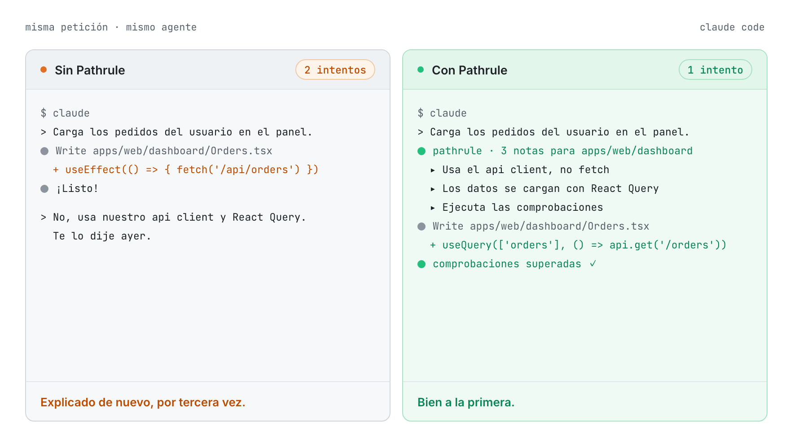
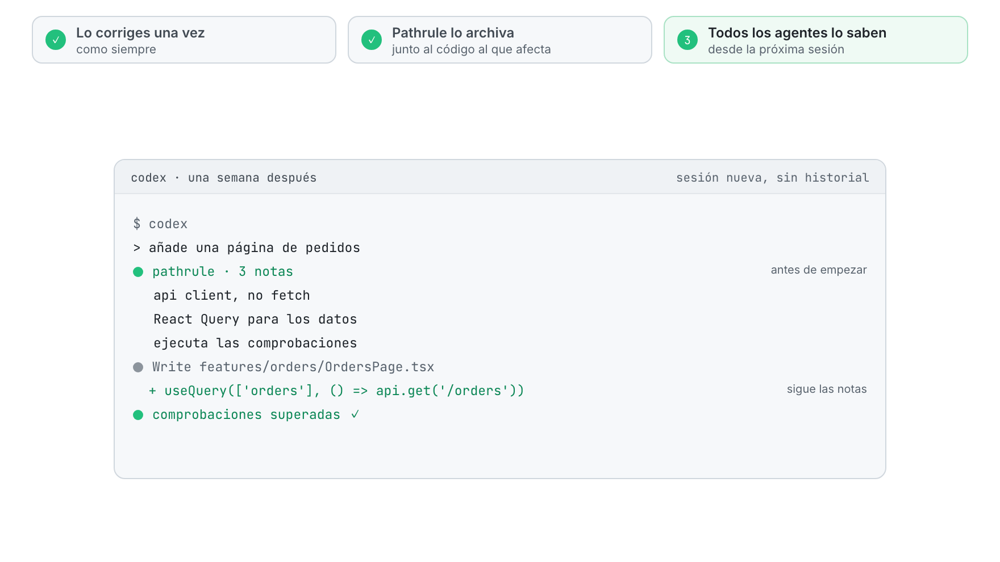
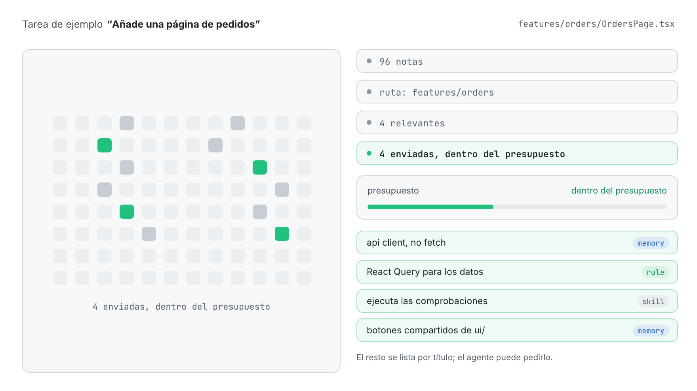
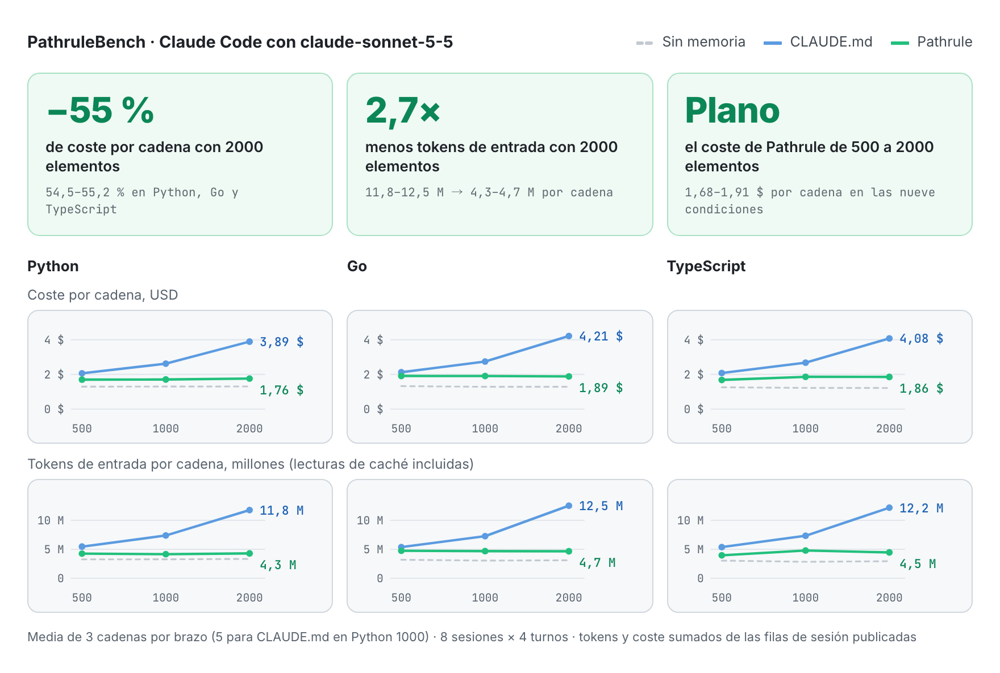
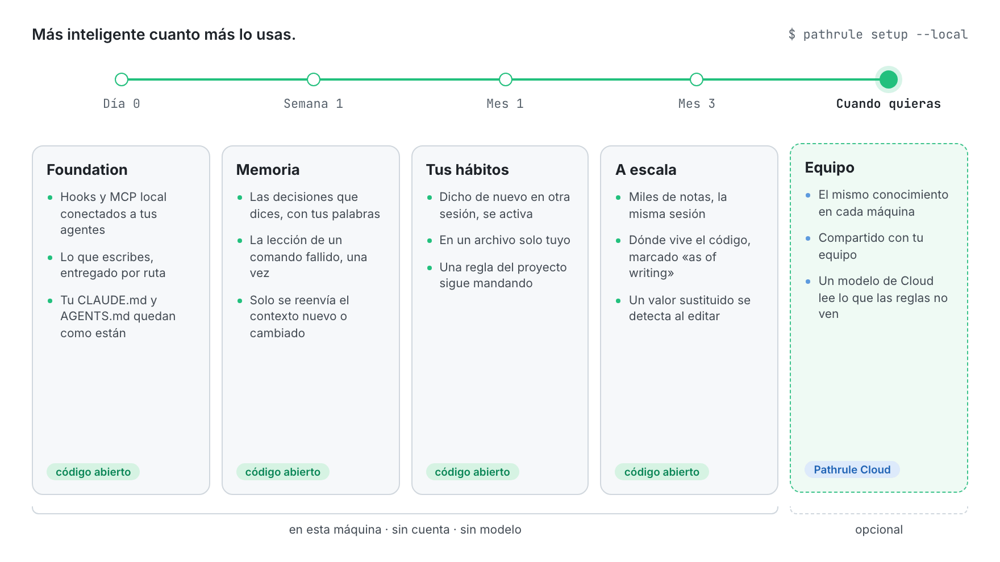
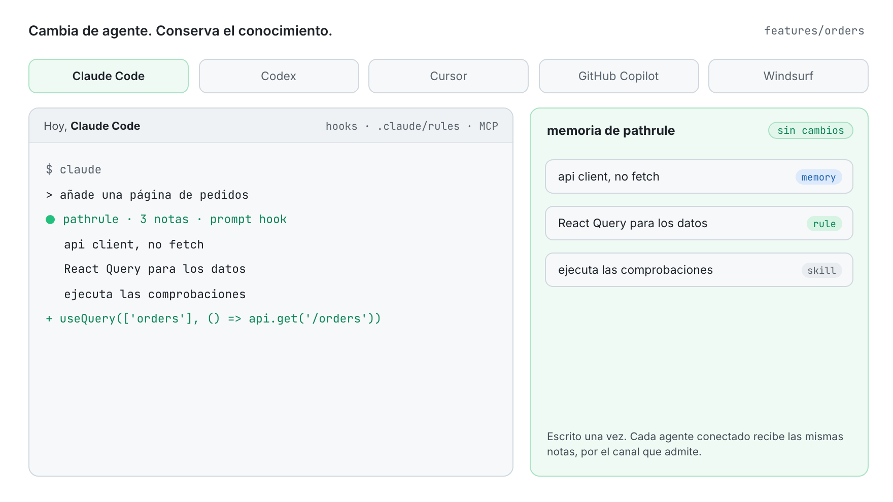

<p align="center">
  <picture>
    <source media="(prefers-color-scheme: dark)" srcset="docs/assets/pathrule-banner-dark.png">
    
  </picture>
</p>

<p align="center">
  <a href="README.md">English</a> · <b>Español</b> · <a href="README.fr.md">Français</a> · <a href="README.de.md">Deutsch</a> · <a href="README.ja.md">日本語</a> · <a href="README.it.md">Italiano</a> · <a href="README.tr.md">Türkçe</a> · <a href="README.pt-BR.md">Português (Brasil)</a>
</p>

<p align="center"><sub>Esta traducción puede ir por detrás del <a href="README.md">README en inglés</a>.</sub></p>

<h3 align="center">Tu IA olvida. Pathrule recuerda.</h3>

<p align="center">
  La capa de conocimiento de código abierto para agentes de programación. Pathrule guarda lo que tu proyecto ha aprendido como memorias, reglas y skills ligadas a rutas de tu código, y da a Claude Code, Codex, Cursor, GitHub Copilot y Windsurf solo lo que necesita la tarea que tienen delante, antes de que actúen.
</p>

<p align="center">
  <a href="https://www.npmjs.com/package/@pathrule/cli"></a>
  <a href="LICENSE"></a>
  <a href="#benchmarks"></a>
  <a href="https://github.com/pathrule/pathrule/actions/workflows/ci.yml"></a>
  <a href="https://marketplace.visualstudio.com/items?itemName=Pathrule.pathrule-vscode"></a>
  <a href="https://open-vsx.org/extension/Pathrule/pathrule-vscode"></a>
</p>

<p align="center">
  <b>PathruleBench, 2000 elementos:</b> 55 % menos coste por cadena · 2,7× menos tokens de entrada · 97 % de sondas de memoria superadas · <a href="#benchmarks">las cifras</a>
</p>

<p align="center">
  <a href="https://www.pathrule.io">Web</a> · <a href="https://www.pathrule.io/docs/start/quickstart">Documentación</a> · <a href="#quickstart">Inicio rápido</a> · <a href="#benchmarks">Benchmarks</a> · <a href="#local-first">Cada vez más listo</a> · <a href="https://www.pathrule.io/changelog">Changelog</a>
</p>

<p align="center">
  <picture>
    <source media="(prefers-color-scheme: dark)" srcset="docs/assets/readme/es/hero-dark.gif">
    
  </picture>
</p>

<p align="center"><sub><i>Misma petición, mismo agente. A la derecha, el hook de Pathrule entrega las tres notas archivadas para <code>apps/web/dashboard</code> antes de que el agente escriba una línea.</i></sub></p>

<p align="center">
  <b>Funciona con</b>  Claude Code · Codex · Cursor · GitHub Copilot · Windsurf · cualquier cliente MCP
</p>

<a id="quickstart"></a>

## Inicio rápido

Node.js 22.14.0 o posterior, en macOS, Linux o Windows.

```bash
npm i -g @pathrule/cli
pathrule setup --local    # sin cuenta: el conocimiento se queda en esta máquina
pathrule doctor           # mira qué recibe cada agente
```

Reinicia tu agente. Desde la siguiente sesión recibe las notas de la ruta que va a tocar, y escribe otras nuevas mientras trabaja.

| Otras formas de empezar | Comando | Ideal para |
| --- | --- | --- |
| Extensión de VS Code | `code --install-extension Pathrule.pathrule-vscode` | Conocimiento junto al código. Marketplace y Open VSX. |
| Plugin de Claude Code / Codex | `/plugin marketplace add pathrule/pathrule` · `codex plugin marketplace add pathrule/pathrule` | Instalarlo desde el propio agente. La configuración muestra un plan antes de cambiar nada. |
| Plugin de Cursor | Cursor Marketplace → Pathrule | Los mismos hooks, MCP y skills dentro de Cursor. |
| Plugin de Gemini CLI / OpenCode | `gemini extensions install https://github.com/pathrule/gemini-cli-extension` · `opencode plugin @pathrule/opencode --global` | La misma configuración en Gemini CLI y OpenCode. |
| Cualquier cliente MCP | `npx -y @pathrule/mcp` | Agentes sin sistema de plugins. Publicado en el MCP Registry oficial. |
| Local Console | `pathrule ui` | Explorar y editar el conocimiento en 127.0.0.1. Sin cuenta. |
| Remote MCP | `claude mcp add --transport http pathrule https://cloud.pathrule.io/mcp` | Probarlo sin instalar nada. Sin hooks ni modo local. |
| Desde el código fuente | `pnpm install && pnpm cli:bundle` | Contribuir a Pathrule. Consulta [docs/quickstart.md](docs/quickstart.md). |

<a id="explain-once"></a>

## Explícalo una vez

Los agentes de programación empiezan cada sesión en blanco. Así que la misma corrección vuelve, día tras día, agente tras agente:

| Día | Agente | Lo que escribiste |  |
| --- | --- | --- | --- |
| Lun | Claude Code | “usa nuestro api client, no fetch” | 1.ª |
| Mar | Claude Code | “otra vez: api client, no fetch” | 2.ª |
| Mié | Codex | “usamos el api client.” | 3.ª |
| Jue | Cursor | “Te lo dije ayer. api client.” | 4.ª |
| Vie | Claude Code | “API CLIENT. NO FETCH.” | 5.ª |

Cinco sesiones, tres agentes, nada recordado. Con Pathrule lo dices una vez:

<p align="center">
  <picture>
    <source media="(prefers-color-scheme: dark)" srcset="docs/assets/readme/es/explain-once-dark.gif">
    
  </picture>
</p>

1. **Lo corriges una vez**, como harías normalmente.
2. **Pathrule lo archiva** junto al código al que afecta: una memoria en `features/`, no una línea más en un archivo que cada sesión tiene que leer.
3. **Todos los agentes lo saben** desde la siguiente sesión, abras el que abras.

<a id="how-it-works"></a>

## Solo lo que importa

Un espacio de trabajo acumula cientos de notas. Un agente que edita `features/orders` necesita cuatro.

<p align="center">
  <picture>
    <source media="(prefers-color-scheme: dark)" srcset="docs/assets/readme/es/only-what-matters-dark.gif">
    
  </picture>
</p>

El conocimiento se selecciona por ruta, alcance y relevancia, y luego se ajusta a un presupuesto por prompt. Las reglas obligatorias nunca se recortan por falta de espacio. Lo que no cabe se lista por título, para que el agente pueda pedirlo. Cuando un prompt nombra una función o un tipo, el hook también lleva al agente al archivo y la línea donde está definido (JS/TS, Python, Go).

### Tres tipos de conocimiento

| Tipo | Qué contiene | Ejemplo en `features/` |
| --- | --- | --- |
| **Memoria** | Decisiones, trampas e incidentes, en markdown breve. | “Usa el api client. Gestiona la autenticación y los reintentos.” |
| **Regla** | Restricciones que el agente debe cumplir, por encima de los consejos. | “La carga de datos pasa por React Query.” |
| **Skill** | Procedimientos y checklists reutilizables que un agente puede ejecutar. | “Ejecuta las comprobaciones antes de darlo por terminado.” |

### Tres vías de entrada

| Canal | Cuándo llega al agente | Coste |
| --- | --- | --- |
| Archivos de reglas por ruta | Claude Code lee al iniciar la sesión la carpeta propia de Pathrule, `.claude/rules/pathrule/`, cada archivo acotado a sus rutas. Tu `CLAUDE.md` y tu `AGENTS.md` quedan como están. | El cliente los guarda en caché. |
| Hooks | Antes de que el agente actúe: al iniciar la sesión, en cada prompt y en las herramientas de archivos. Solo se reenvía el contexto nuevo o cambiado. | Con presupuesto por prompt. |
| MCP `get_context` | Cuando el agente lo pide, con la profundidad que necesita la petición. | Disponible en todo cliente MCP. |

<a id="benchmarks"></a>

## ¿Por qué no basta con CLAUDE.md?

<a href="https://github.com/pathrule/benchmark"></a>

**Un archivo CLAUDE.md se lee entero en cada paso, así que cada nota que añade tu equipo encarece cada sesión. Pathrule envía a cada prompt solo lo que necesitan la ruta y la tarea.** PathruleBench midió la diferencia con el mismo agente, los mismos prompts y las mismas comprobaciones ocultas, de 500 a 2000 elementos de conocimiento de equipo.

<p align="center">
  <picture>
    <source media="(prefers-color-scheme: dark)" srcset="docs/assets/readme/es/bench-cost-tokens-dark.png">
    
  </picture>
</p>

<div align="center">

| Con 2000 elementos de conocimiento | CLAUDE.md | Pathrule |
| :-- | :-: | :-: |
| Coste de una cadena de 8 sesiones | 3,89–4,21 $ | **1,76–1,89 $** |
| Tokens de entrada por cadena | 11,8–12,5 M | **4,3–4,7 M** |
| Sondas de memoria superadas | 89 % | **97 %** |
| Cadenas que superaron todas las sondas | 0 de 9 | **5 de 9** |
| Un hábito dicho una vez, respetado después | 78 % | **97 %** |
| Lo que enseñó un comando fallido, conservado | 33 % | **78 %** |
| El trabajo que pedía cada prompt | 100 % | **100 %** |

</div>

De 500 a 2000 elementos, una cadena con CLAUDE.md cuesta entre un 89 y un 98 % más. Con Pathrule varía entre −1 % y +10 %. Tu base de conocimiento puede crecer; la factura, no.

<sub>Claude Code con claude-sonnet-5-5 en Python, Go y TypeScript; nueve cadenas por brazo con 2000 elementos (tres por lenguaje); los tests ejecutables deciden cada acierto, ningún modelo juzga. El brazo de Pathrule es la CLI de código abierto de este repositorio en modo local: sin Cloud, sin modelo.</sub>

**[Cada condición, cadena y comprobación, y cómo ejecutarlo tú → pathrule/benchmark](https://github.com/pathrule/benchmark)**

<a id="local-first"></a>

## Más inteligente cuanto más lo usas.

El primer día no necesita cuenta, ni red, ni modelo. Todo lo que viene después se apoya en lo que tú y tus agentes ya hicisteis en este repositorio.

<p align="center">
  <picture>
    <source media="(prefers-color-scheme: dark)" srcset="docs/assets/readme/es/over-time-dark.gif">
    
  </picture>
</p>

| Cuándo | Qué hace Pathrule | Dónde se ejecuta |
| --- | --- | --- |
| **Día 0**<br>Foundation | Los hooks y el servidor MCP local se conectan a tus agentes. Lo que escribes se entrega por ruta, dentro de un presupuesto, mediante los hooks y las reglas por ruta de Claude Code; tu `CLAUDE.md` y tu `AGENTS.md` quedan como están. | Código abierto, esta máquina |
| **Semana 1**<br>Memoria | Una decisión que dices en un prompt («a partir de ahora…», «hemos decidido…») se guarda con tus propias palabras. Una lección que enseñó un comando fallido se guarda una vez. Cada nota se archiva junto al código al que se refiere, y solo se reenvía el contexto nuevo o cambiado. | Código abierto, esta máquina |
| **Mes 1**<br>Tus hábitos | Una preferencia que expresas vive en un archivo local tuyo. Dicha una vez de pasada, espera; dicha de nuevo en otra sesión, llega a todos los agentes. La que declaras duradera rige desde ese momento. Una regla del proyecto siempre se impone a una personal. | Código abierto, esta máquina |
| **Mes 3**<br>A escala | Miles de notas, y una sesión sigue teniendo el mismo tamaño: el archivo raíz de reglas se queda en unos 6000 caracteres y el resto llega por prompt. Una frase que dice dónde vive el código se marca con `(as of writing)`, así que cuando un compañero mueve el archivo, el agente sigue al código. Cuando una edición escribe un valor que una decisión más reciente sustituyó, el hook cita la decisión en esa edición. | Código abierto, esta máquina |
| **Cuando quieras**<br>Equipo | El mismo conocimiento en cada máquina y para cada miembro. En un workspace de Cloud, un modelo también lee los prompts en los que las reglas de frases de Pathrule no encontraron nada y guarda la frase que querías que perdurara, con tus palabras. Se paga con AI Credits. | Pathrule Cloud, opcional |

<sub>En tu máquina no se ejecuta ningún modelo. Todo lo anterior a Equipo es la CLI de código abierto, la misma ruta que midió el benchmark de arriba.</sub>

<a id="agents"></a>

## Cambia de agente. Conserva el conocimiento.

<p align="center">
  <picture>
    <source media="(prefers-color-scheme: dark)" srcset="docs/assets/readme/es/any-agent-dark.gif">
    
  </picture>
</p>

| Agente | Antes de actuar | Archivo de instrucciones | MCP |
| --- | --- | --- | --- |
| Claude Code | Hooks, incluido el de prompt | La carpeta propia de Pathrule, `.claude/rules/pathrule/` | Local o remoto |
| Codex | Hooks, incluido el de prompt | — | Local o remoto |
| Cursor | — | — | Local |
| GitHub Copilot | — | — | Local |
| Windsurf | — | — | Local |
| Cualquier cliente MCP | — | — | Local o remoto |

<a id="vs-rules-files"></a>

## No es otro archivo de reglas

|  | Un archivo de reglas | Pathrule |
| --- | --- | --- |
| Se escribe | A mano, y se mantiene a mano | Crece mientras tú y tus agentes trabajáis |
| Llega a | Una herramienta por archivo | Todos los agentes conectados |
| Se entrega | Todo, en cada sesión | Solo lo que necesitan la ruta y la tarea |
| Cambia | Cuando alguien lo edita | Versionado; el conocimiento nuevo sustituye al antiguo |

Conserva tu `CLAUDE.md` y tu `AGENTS.md`: Pathrule no los edita. Entrega el resto por ruta y por tarea, donde un solo archivo no llega.

<a id="repository"></a>

## Qué hay en este repositorio

Esta es la base de código abierto de Pathrule. Funciona sin cuenta y sin ningún servicio de red: el almacén, la recuperación y el ranking, el servidor MCP, los hooks, el ciclo de aprendizaje y la CLI.

| Parte | Aquí | Licencia |
| --- | --- | --- |
| **Foundation**: protocolo, agent IR, almacén local de conocimiento, host, servidor MCP, CLI, cliente de Pathrule Cloud, integraciones con agentes, Local Console, extensión de VS Code | Sí | Apache-2.0 |
| **Pathrule Cloud**: espacios de equipo, sincronización, la consola web, Remote MCP, el nivel de modelo de Cloud | No | Propietario |

<details>
<summary><b>Los 11 paquetes</b></summary>

[`protocol`](packages/protocol) · [`agent-ir`](packages/agent-ir) · [`core`](packages/core) · [`integrations`](packages/integrations) · [`mcp`](packages/mcp) · [`host`](packages/host) · [`ui`](packages/ui) · [`local-console`](packages/local-console) · [`cloud`](packages/cloud) · [`cli`](packages/cli) · [`vscode`](packages/vscode)

</details>

```bash
pnpm install
pnpm typecheck      # todos los paquetes
pnpm test           # los tests de cada paquete
pnpm build          # la build npm de cada paquete
```

<a id="privacy"></a>

## Tu código sigue siendo tuyo

- El código fuente nunca se sube automáticamente.
- El modo local no usa cuenta ni ejecuta ningún modelo, y la CLI abierta no envía telemetría.
- Tu agente mantiene su propio proveedor de modelos. Pathrule no es un modelo, ni un agente, ni un IDE.
- Pathrule Cloud es opcional. Con la sesión iniciada, guarda tu conocimiento y usa el prompt para ordenarlo, y su nivel de modelo puede leer un prompt para encontrar una decisión pensada para durar.

<a id="community"></a>

## Comunidad

<a href="https://star-history.com/#pathrule/pathrule&Date">
  <picture>
    <source media="(prefers-color-scheme: dark)" srcset="https://api.star-history.com/svg?repos=pathrule/pathrule&type=Date&theme=dark">
    
  </picture>
</a>

### Colaboradores

<a href="https://github.com/pathrule/pathrule/graphs/contributors">
  
</a>

[Contribuir](CONTRIBUTING.md) (firma DCO) · [Código de conducta](CODE_OF_CONDUCT.md) · [Informar de una vulnerabilidad](SECURITY.md) · [Obtener ayuda](SUPPORT.md) · [Política de marca](TRADEMARKS.md)

<a id="license"></a>

## Licencia

Apache-2.0. Consulta [LICENSE](LICENSE) y [NOTICE](NOTICE). El nombre y el logotipo de Pathrule no están licenciados bajo Apache-2.0.

<p align="center">
  <a href="https://www.pathrule.io">pathrule.io</a> · <a href="https://www.pathrule.io/docs">Documentación</a> · <a href="https://www.pathrule.io/products/cloud">Pathrule Cloud</a>
</p>
