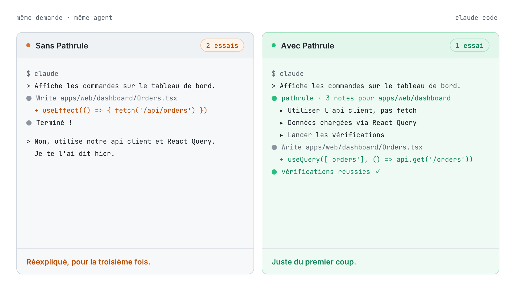
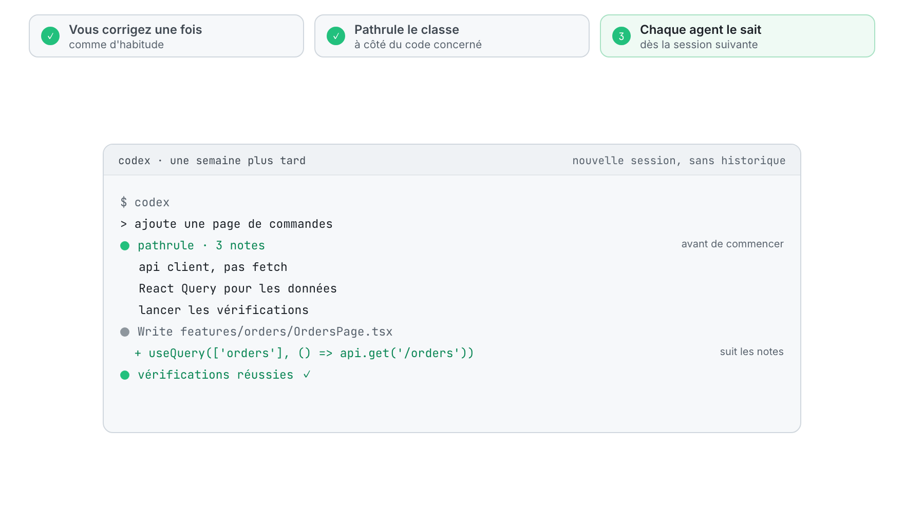
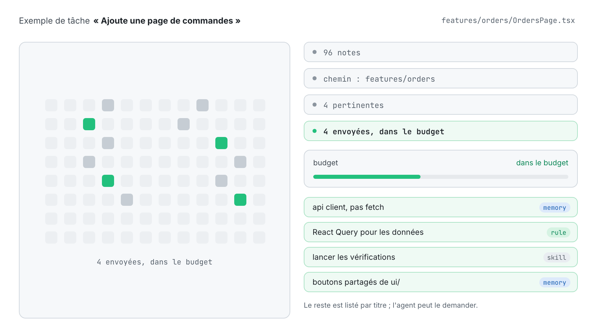
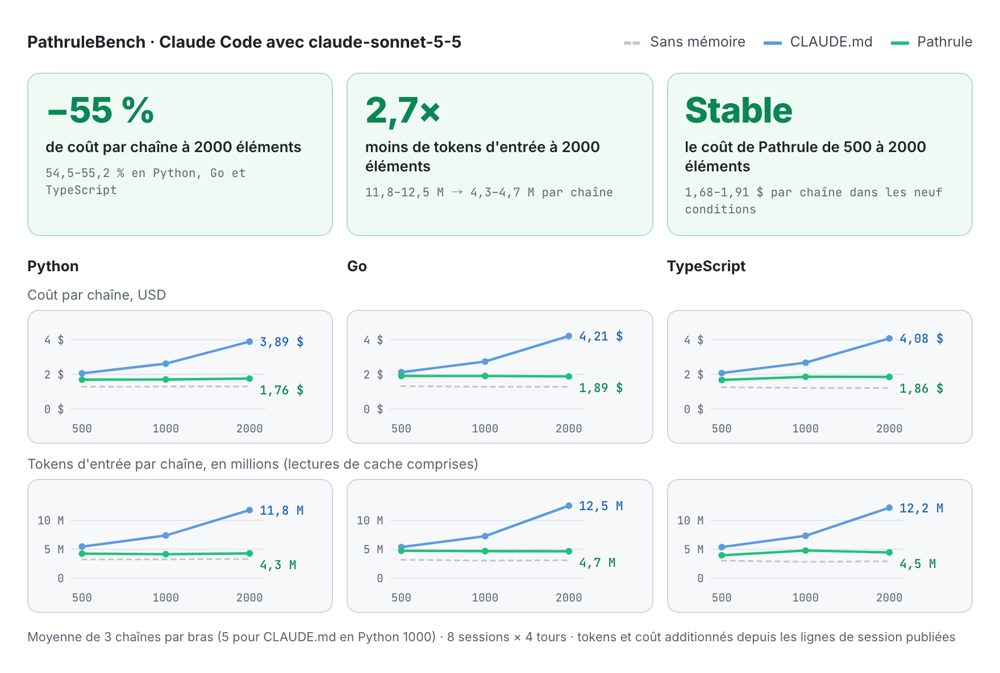
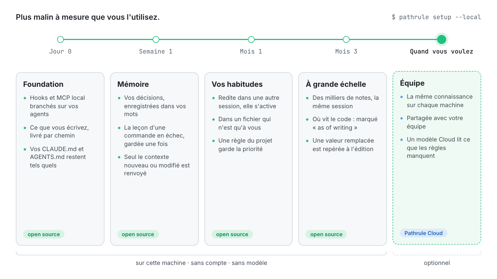
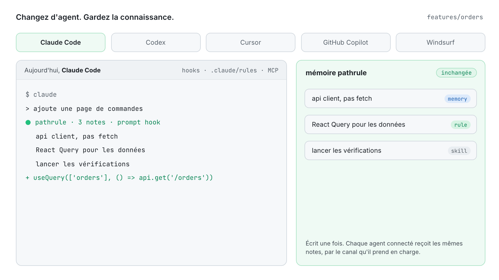

<p align="center">
  <picture>
    <source media="(prefers-color-scheme: dark)" srcset="docs/assets/pathrule-banner-dark.png">
    
  </picture>
</p>

<p align="center">
  <a href="README.md">English</a> · <a href="README.es.md">Español</a> · <b>Français</b> · <a href="README.de.md">Deutsch</a> · <a href="README.ja.md">日本語</a> · <a href="README.it.md">Italiano</a> · <a href="README.tr.md">Türkçe</a> · <a href="README.pt-BR.md">Português (Brasil)</a>
</p>

<p align="center"><sub>Cette traduction peut être en retard sur le <a href="README.md">README anglais</a>.</sub></p>

<h3 align="center">Votre IA oublie. Pathrule se souvient.</h3>

<p align="center">
  La couche de connaissance open source pour les agents de code. Pathrule conserve ce que votre projet a appris sous forme de mémoires, de règles et de skills rattachées aux chemins de votre code, et donne à Claude Code, Codex, Cursor, GitHub Copilot et Windsurf uniquement ce dont la tâche en cours a besoin, avant qu'ils n'agissent.
</p>

<p align="center">
  <a href="https://www.npmjs.com/package/@pathrule/cli"></a>
  <a href="LICENSE"></a>
  <a href="#benchmarks"></a>
  <a href="https://github.com/pathrule/pathrule/actions/workflows/ci.yml"></a>
  <a href="https://marketplace.visualstudio.com/items?itemName=Pathrule.pathrule-vscode"></a>
  <a href="https://open-vsx.org/extension/Pathrule/pathrule-vscode"></a>
</p>

<p align="center">
  <b>PathruleBench, 2000 éléments :</b> 55 % de coût en moins par chaîne · 2,7× moins de tokens d'entrée · 97 % des sondes de mémoire réussies · <a href="#benchmarks">les chiffres</a>
</p>

<p align="center">
  <a href="https://www.pathrule.io">Site web</a> · <a href="https://www.pathrule.io/docs/start/quickstart">Documentation</a> · <a href="#quickstart">Démarrage rapide</a> · <a href="#benchmarks">Benchmarks</a> · <a href="#local-first">Plus malin avec le temps</a> · <a href="https://www.pathrule.io/changelog">Changelog</a>
</p>

<p align="center">
  <picture>
    <source media="(prefers-color-scheme: dark)" srcset="docs/assets/readme/fr/hero-dark.gif">
    
  </picture>
</p>

<p align="center"><sub><i>Même demande, même agent. À droite, le hook de Pathrule transmet les trois notes classées pour <code>apps/web/dashboard</code> avant que l'agent n'écrive une ligne.</i></sub></p>

<p align="center">
  <b>Fonctionne avec</b>  Claude Code · Codex · Cursor · GitHub Copilot · Windsurf · tout client MCP
</p>

<a id="quickstart"></a>

## Démarrage rapide

Node.js 22.14.0 ou plus récent, sur macOS, Linux ou Windows.

```bash
npm i -g @pathrule/cli
pathrule setup --local    # sans compte : la connaissance reste sur cette machine
pathrule doctor           # voir ce que reçoit chaque agent
```

Redémarrez votre agent. Dès la session suivante, il reçoit les notes du chemin qu'il s'apprête à modifier, et en écrit de nouvelles en travaillant.

| Autres façons de commencer | Commande | Idéal pour |
| --- | --- | --- |
| Extension VS Code | `code --install-extension Pathrule.pathrule-vscode` | La connaissance à côté du code. Marketplace et Open VSX. |
| Plugin Claude Code / Codex | `/plugin marketplace add pathrule/pathrule` · `codex plugin marketplace add pathrule/pathrule` | Installer depuis l'agent lui-même. La configuration montre un plan avant de modifier quoi que ce soit. |
| Plugin Cursor | Cursor Marketplace → Pathrule | Les mêmes hooks, MCP et skills dans Cursor. |
| Plugin Gemini CLI / OpenCode | `gemini extensions install https://github.com/pathrule/gemini-cli-extension` · `opencode plugin @pathrule/opencode --global` | La même configuration dans Gemini CLI et OpenCode. |
| Tout client MCP | `npx -y @pathrule/mcp` | Les agents sans système de plugins. Référencé dans le MCP Registry officiel. |
| Local Console | `pathrule ui` | Parcourir et modifier la connaissance sur 127.0.0.1. Sans compte. |
| Remote MCP | `claude mcp add --transport http pathrule https://cloud.pathrule.io/mcp` | Essayer sans rien installer. Sans hooks ni mode local. |
| Depuis les sources | `pnpm install && pnpm cli:bundle` | Contribuer à Pathrule. Voir [docs/quickstart.md](docs/quickstart.md). |

<a id="explain-once"></a>

## Expliquez-le une fois

Les agents de code commencent chaque session à zéro. Alors la même correction revient, jour après jour, agent après agent :

| Jour | Agent | Ce que vous avez tapé |  |
| --- | --- | --- | --- |
| Lun | Claude Code | « utilise notre api client, pas fetch » | 1re |
| Mar | Claude Code | « encore : api client, pas fetch » | 2e |
| Mer | Codex | « on utilise l'api client. » | 3e |
| Jeu | Cursor | « Je te l'ai dit hier. api client. » | 4e |
| Ven | Claude Code | « API CLIENT. PAS FETCH. » | 5e |

Cinq sessions, trois agents, rien de retenu. Avec Pathrule, vous le dites une fois :

<p align="center">
  <picture>
    <source media="(prefers-color-scheme: dark)" srcset="docs/assets/readme/fr/explain-once-dark.gif">
    
  </picture>
</p>

1. **Vous corrigez une fois**, comme d'habitude.
2. **Pathrule le classe** à côté du code concerné : une mémoire sur `features/`, pas une ligne de plus dans un fichier que chaque session doit lire.
3. **Chaque agent le sait** dès la session suivante, quel que soit celui que vous ouvrez.

<a id="how-it-works"></a>

## Seulement ce qui compte

Un espace de travail accumule des centaines de notes. Un agent qui modifie `features/orders` en a besoin de quatre.

<p align="center">
  <picture>
    <source media="(prefers-color-scheme: dark)" srcset="docs/assets/readme/fr/only-what-matters-dark.gif">
    
  </picture>
</p>

La connaissance est sélectionnée par chemin, portée et pertinence, puis ajustée à un budget par prompt. Les règles imposées ne sont jamais coupées faute de place. Ce qui ne rentre pas est listé par titre, pour que l'agent puisse le demander. Quand un prompt nomme une fonction ou un type, le hook indique aussi à l'agent le fichier et la ligne où il est défini (JS/TS, Python, Go).

### Trois types de connaissance

| Type | Ce qu'il contient | Exemple sur `features/` |
| --- | --- | --- |
| **Mémoire** | Décisions, pièges et incidents, en markdown court. | « Utiliser l'api client. Il gère l'authentification et les relances. » |
| **Règle** | Contraintes que l'agent doit respecter, placées au-dessus des conseils. | « Le chargement des données passe par React Query. » |
| **Skill** | Procédures et checklists réutilisables qu'un agent peut exécuter. | « Lancer les vérifications avant de considérer la tâche terminée. » |

### Trois points d'entrée

| Canal | Quand il atteint l'agent | Coût |
| --- | --- | --- |
| Fichiers de règles par chemin | Claude Code lit au début de la session le dossier propre à Pathrule, `.claude/rules/pathrule/`, chaque fichier limité à ses chemins. Vos `CLAUDE.md` et `AGENTS.md` restent tels quels. | Mis en cache par le client. |
| Hooks | Avant que l'agent n'agisse : au début de la session, à chaque prompt et sur les outils de fichiers. Seul le contexte nouveau ou modifié est renvoyé. | Budget par prompt. |
| MCP `get_context` | Quand l'agent le demande, à la profondeur dont la requête a besoin. | Disponible dans tout client MCP. |

<a id="benchmarks"></a>

## Pourquoi pas simplement CLAUDE.md ?

<a href="https://github.com/pathrule/benchmark"></a>

**Un fichier CLAUDE.md est lu en entier à chaque étape : chaque note ajoutée par votre équipe rend chaque session plus chère. Pathrule n'envoie à chaque prompt que ce dont le chemin et la tâche ont besoin.** PathruleBench a mesuré l'écart avec le même agent, les mêmes prompts et les mêmes vérifications cachées, de 500 à 2000 éléments de connaissance d'équipe.

<p align="center">
  <picture>
    <source media="(prefers-color-scheme: dark)" srcset="docs/assets/readme/fr/bench-cost-tokens-dark.png">
    
  </picture>
</p>

<div align="center">

| À 2000 éléments de connaissance | CLAUDE.md | Pathrule |
| :-- | :-: | :-: |
| Coût d'une chaîne de 8 sessions | 3,89–4,21 $ | **1,76–1,89 $** |
| Tokens d'entrée par chaîne | 11,8–12,5 M | **4,3–4,7 M** |
| Sondes de mémoire réussies | 89 % | **97 %** |
| Chaînes qui ont réussi toutes les sondes | 0 sur 9 | **5 sur 9** |
| Une habitude dite une fois, suivie ensuite | 78 % | **97 %** |
| Ce qu'une commande en échec a appris, conservé | 33 % | **78 %** |
| Le travail demandé par chaque prompt | 100 % | **100 %** |

</div>

De 500 à 2000 éléments, une chaîne avec CLAUDE.md coûte de 89 à 98 % de plus. Avec Pathrule, l'écart reste entre −1 % et +10 %. Votre base de connaissance peut grandir ; la facture, non.

<sub>Claude Code avec claude-sonnet-5-5 en Python, Go et TypeScript ; neuf chaînes par bras à 2000 éléments (trois par langage) ; des tests exécutables décident de chaque réussite, aucun modèle ne juge. Le bras Pathrule est la CLI open source de ce dépôt en mode local : sans Cloud, sans modèle.</sub>

**[Chaque condition, chaîne et vérification, et comment le lancer vous-même → pathrule/benchmark](https://github.com/pathrule/benchmark)**

<a id="local-first"></a>

## Plus malin à mesure que vous l'utilisez.

Le premier jour ne demande ni compte, ni réseau, ni modèle. Tout ce qui suit s'appuie sur ce que vous et vos agents avez déjà fait dans ce dépôt.

<p align="center">
  <picture>
    <source media="(prefers-color-scheme: dark)" srcset="docs/assets/readme/fr/over-time-dark.gif">
    
  </picture>
</p>

| Quand | Ce que fait Pathrule | Où ça tourne |
| --- | --- | --- |
| **Jour 0**<br>Foundation | Les hooks et le serveur MCP local sont branchés sur vos agents. Ce que vous écrivez est livré par chemin, dans un budget, par les hooks et les règles par chemin de Claude Code ; vos `CLAUDE.md` et `AGENTS.md` restent tels quels. | Open source, cette machine |
| **Semaine 1**<br>Mémoire | Une décision que vous énoncez dans un prompt (« désormais… », « nous avons décidé… ») est enregistrée dans vos propres mots. Une leçon tirée d'une commande en échec est enregistrée une fois. Chaque note est rangée à côté du code qu'elle concerne, et seul le contexte nouveau ou modifié est renvoyé. | Open source, cette machine |
| **Mois 1**<br>Vos habitudes | Une préférence que vous exprimez vit dans un fichier local qui vous appartient. Dite une fois en passant, elle attend ; redite dans une autre session, elle atteint chaque agent. Celle que vous déclarez durable s'applique aussitôt. Une règle du projet l'emporte toujours sur une règle personnelle. | Open source, cette machine |
| **Mois 3**<br>À grande échelle | Des milliers de notes, et une session garde la même taille : le fichier de règles racine reste autour de 6000 caractères et le reste arrive par prompt. Une phrase qui dit où se trouve le code est marquée `(as of writing)` : quand un collègue déplace le fichier, l'agent suit le code. Quand une modification écrit une valeur qu'une décision plus récente a remplacée, le hook cite la décision à ce moment-là. | Open source, cette machine |
| **Quand vous voulez**<br>Équipe | La même connaissance sur chaque machine et pour chaque membre. Pour un workspace Cloud, un modèle lit aussi les prompts où les règles de phrases de Pathrule n'ont rien trouvé et conserve la phrase que vous vouliez durable, dans vos mots. Il est payé en AI Credits. | Pathrule Cloud, optionnel |

<sub>Aucun modèle ne tourne sur votre machine. Tout ce qui précède Équipe est la CLI open source, le même chemin que le benchmark ci-dessus a mesuré.</sub>

<a id="agents"></a>

## Changez d'agent. Gardez la connaissance.

<p align="center">
  <picture>
    <source media="(prefers-color-scheme: dark)" srcset="docs/assets/readme/fr/any-agent-dark.gif">
    
  </picture>
</p>

| Agent | Avant d'agir | Fichier d'instructions | MCP |
| --- | --- | --- | --- |
| Claude Code | Hooks, hook de prompt compris | Le dossier propre à Pathrule, `.claude/rules/pathrule/` | Local ou distant |
| Codex | Hooks, hook de prompt compris | — | Local ou distant |
| Cursor | — | — | Local |
| GitHub Copilot | — | — | Local |
| Windsurf | — | — | Local |
| Tout client MCP | — | — | Local ou distant |

<a id="vs-rules-files"></a>

## Pas un fichier de règles de plus

|  | Un fichier de règles | Pathrule |
| --- | --- | --- |
| Écrit | À la main, tenu à jour à la main | S'enrichit pendant que vous et vos agents travaillez |
| Atteint | Un outil par fichier | Chaque agent connecté |
| Livré | En entier, à chaque session | Seulement ce dont le chemin et la tâche ont besoin |
| Évolue | Quand quelqu'un le modifie | Versionné ; la nouvelle connaissance remplace l'ancienne |

Gardez vos `CLAUDE.md` et `AGENTS.md` : Pathrule ne les modifie pas. Il livre le reste par chemin et par tâche, là où un seul fichier ne peut pas.

<a id="repository"></a>

## Contenu de ce dépôt

Voici la base open source de Pathrule. Elle fonctionne sans compte et sans service réseau : le stockage, la recherche et le classement, le serveur MCP, les hooks, la boucle d'apprentissage et la CLI.

| Partie | Ici | Licence |
| --- | --- | --- |
| **Foundation** : protocole, agent IR, stockage local de la connaissance, host, serveur MCP, CLI, client Pathrule Cloud, intégrations d'agents, Local Console, extension VS Code | Oui | Apache-2.0 |
| **Pathrule Cloud** : espaces d'équipe, synchronisation, la console web, Remote MCP, le niveau de modèle du Cloud | Non | Propriétaire |

<details>
<summary><b>Les 11 paquets</b></summary>

[`protocol`](packages/protocol) · [`agent-ir`](packages/agent-ir) · [`core`](packages/core) · [`integrations`](packages/integrations) · [`mcp`](packages/mcp) · [`host`](packages/host) · [`ui`](packages/ui) · [`local-console`](packages/local-console) · [`cloud`](packages/cloud) · [`cli`](packages/cli) · [`vscode`](packages/vscode)

</details>

```bash
pnpm install
pnpm typecheck      # tous les paquets
pnpm test           # les tests de chaque paquet
pnpm build          # la build npm de chaque paquet
```

<a id="privacy"></a>

## Votre code reste le vôtre

- Le code source n'est jamais envoyé automatiquement.
- Le mode local se passe de compte, n'exécute aucun modèle, et la CLI open source n'envoie aucune télémétrie.
- Votre agent garde son propre fournisseur de modèle. Pathrule n'est ni un modèle, ni un agent, ni un IDE.
- Pathrule Cloud est optionnel. Une fois connecté, il stocke votre connaissance et utilise le prompt pour la classer, et son niveau de modèle peut lire un prompt pour y trouver une décision faite pour durer.

<a id="community"></a>

## Communauté

<a href="https://star-history.com/#pathrule/pathrule&Date">
  <picture>
    <source media="(prefers-color-scheme: dark)" srcset="https://api.star-history.com/svg?repos=pathrule/pathrule&type=Date&theme=dark">
    
  </picture>
</a>

### Contributeurs

<a href="https://github.com/pathrule/pathrule/graphs/contributors">
  
</a>

[Contribuer](CONTRIBUTING.md) (signature DCO) · [Code de conduite](CODE_OF_CONDUCT.md) · [Signaler une vulnérabilité](SECURITY.md) · [Obtenir de l'aide](SUPPORT.md) · [Politique de marque](TRADEMARKS.md)

<a id="license"></a>

## Licence

Apache-2.0. Voir [LICENSE](LICENSE) et [NOTICE](NOTICE). Le nom et le logo Pathrule ne sont pas couverts par la licence Apache-2.0.

<p align="center">
  <a href="https://www.pathrule.io">pathrule.io</a> · <a href="https://www.pathrule.io/docs">Documentation</a> · <a href="https://www.pathrule.io/products/cloud">Pathrule Cloud</a>
</p>
