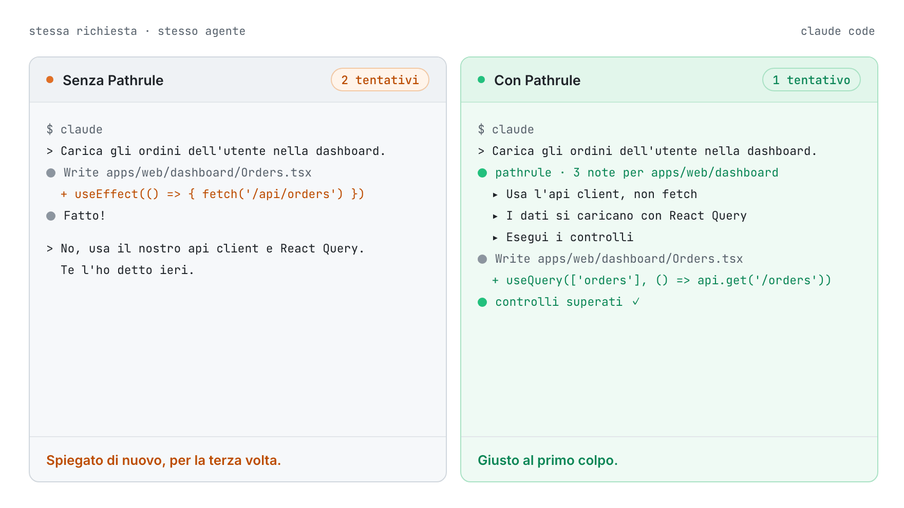
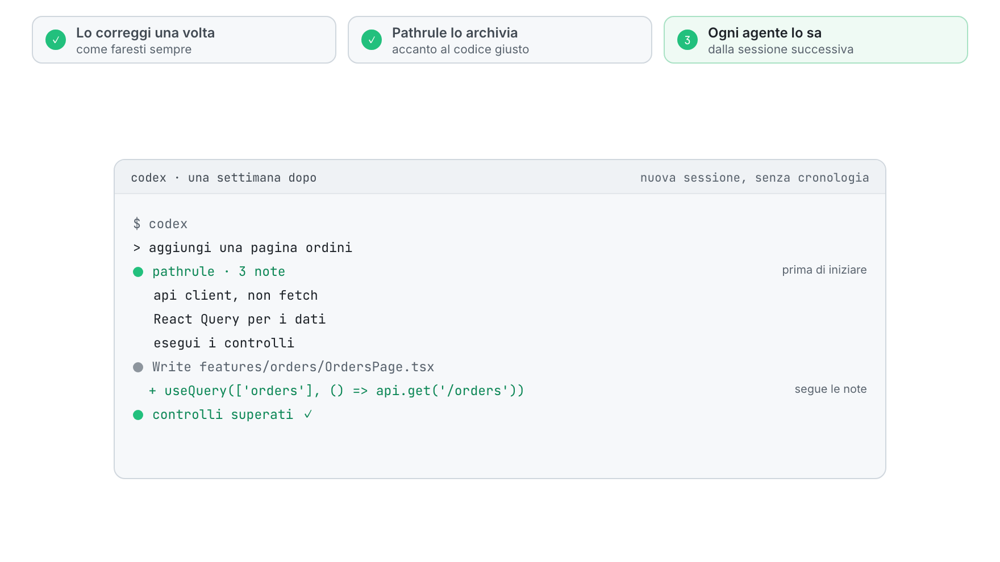
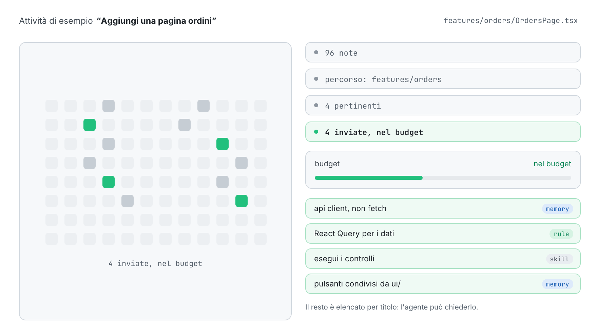
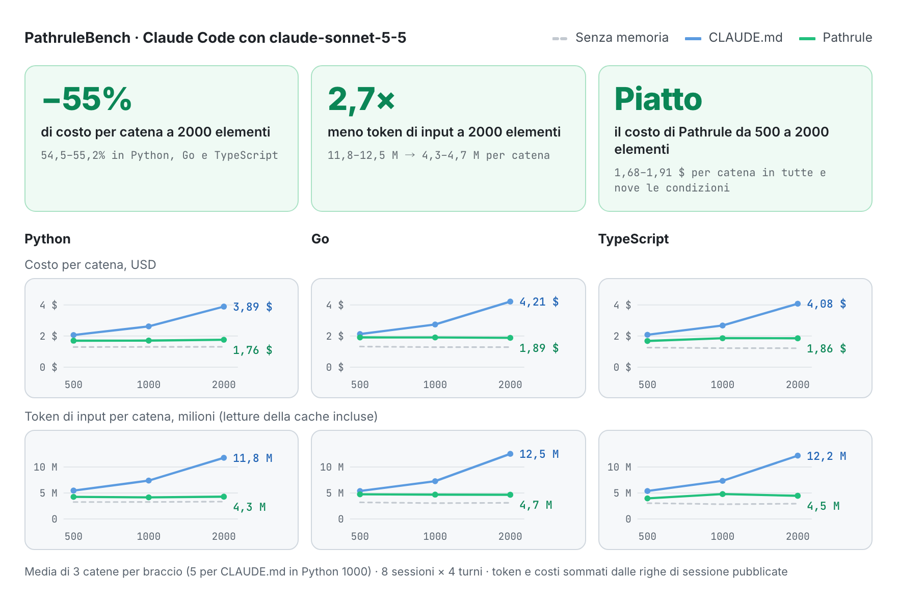
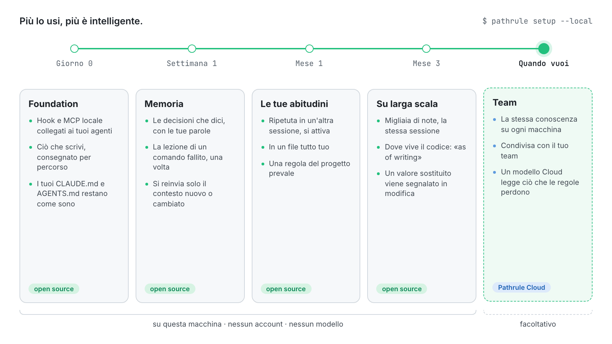
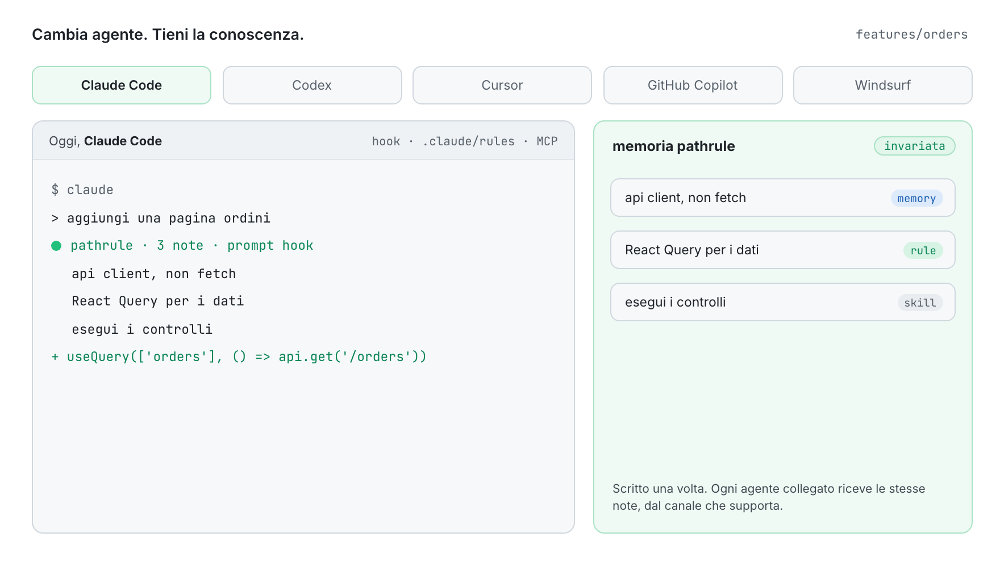

<p align="center">
  <picture>
    <source media="(prefers-color-scheme: dark)" srcset="docs/assets/pathrule-banner-dark.png">
    
  </picture>
</p>

<p align="center">
  <a href="README.md">English</a> · <a href="README.es.md">Español</a> · <a href="README.fr.md">Français</a> · <a href="README.de.md">Deutsch</a> · <a href="README.ja.md">日本語</a> · <b>Italiano</b> · <a href="README.tr.md">Türkçe</a> · <a href="README.pt-BR.md">Português (Brasil)</a>
</p>

<p align="center"><sub>Questa traduzione potrebbe non essere allineata al <a href="README.md">README in inglese</a>.</sub></p>

<h3 align="center">La tua IA dimentica. Pathrule ricorda.</h3>

<p align="center">
  Il livello di conoscenza open source per gli agenti di programmazione. Pathrule conserva ciò che il tuo progetto ha imparato come memorie, regole e skill legate ai percorsi del codice, e dà a Claude Code, Codex, Cursor, GitHub Copilot e Windsurf solo ciò che serve al compito che hanno davanti, prima che agiscano.
</p>

<p align="center">
  <a href="https://www.npmjs.com/package/@pathrule/cli"></a>
  <a href="LICENSE"></a>
  <a href="#benchmarks"></a>
  <a href="https://github.com/pathrule/pathrule/actions/workflows/ci.yml"></a>
  <a href="https://marketplace.visualstudio.com/items?itemName=Pathrule.pathrule-vscode"></a>
  <a href="https://open-vsx.org/extension/Pathrule/pathrule-vscode"></a>
</p>

<p align="center">
  <b>PathruleBench, 2000 elementi:</b> 55% di costo in meno per catena · 2,7× meno token di input · 97% delle sonde di memoria superate · <a href="#benchmarks">i numeri</a>
</p>

<p align="center">
  <a href="https://www.pathrule.io">Sito</a> · <a href="https://www.pathrule.io/docs/start/quickstart">Documentazione</a> · <a href="#quickstart">Avvio rapido</a> · <a href="#benchmarks">Benchmark</a> · <a href="#local-first">Più intelligente col tempo</a> · <a href="https://www.pathrule.io/changelog">Changelog</a>
</p>

<p align="center">
  <picture>
    <source media="(prefers-color-scheme: dark)" srcset="docs/assets/readme/it/hero-dark.gif">
    
  </picture>
</p>

<p align="center"><sub><i>Stessa richiesta, stesso agente. A destra, l'hook di Pathrule consegna le tre note archiviate per <code>apps/web/dashboard</code> prima che l'agente scriva una riga.</i></sub></p>

<p align="center">
  <b>Funziona con</b>  Claude Code · Codex · Cursor · GitHub Copilot · Windsurf · qualsiasi client MCP
</p>

<a id="quickstart"></a>

## Avvio rapido

Node.js 22.14.0 o successivo, su macOS, Linux o Windows.

```bash
npm i -g @pathrule/cli
pathrule setup --local    # nessun account: la conoscenza resta su questa macchina
pathrule doctor           # guarda cosa riceve ogni agente
```

Riavvia il tuo agente. Dalla sessione successiva riceve le note del percorso che sta per toccare, e ne scrive di nuove mentre lavora.

| Altri modi per iniziare | Comando | Ideale per |
| --- | --- | --- |
| Estensione VS Code | `code --install-extension Pathrule.pathrule-vscode` | La conoscenza accanto al codice. Marketplace e Open VSX. |
| Plugin per Claude Code / Codex | `/plugin marketplace add pathrule/pathrule` · `codex plugin marketplace add pathrule/pathrule` | Installarlo dall'interno dell'agente. La configurazione mostra un piano prima di cambiare qualsiasi cosa. |
| Plugin per Cursor | Cursor Marketplace → Pathrule | Gli stessi hook, MCP e skill dentro Cursor. |
| Plugin per Gemini CLI / OpenCode | `gemini extensions install https://github.com/pathrule/gemini-cli-extension` · `opencode plugin @pathrule/opencode --global` | La stessa configurazione in Gemini CLI e OpenCode. |
| Qualsiasi client MCP | `npx -y @pathrule/mcp` | Agenti senza un sistema di plugin. Presente nel MCP Registry ufficiale. |
| Local Console | `pathrule ui` | Sfogliare e modificare la conoscenza su 127.0.0.1. Nessun account. |
| Remote MCP | `claude mcp add --transport http pathrule https://cloud.pathrule.io/mcp` | Provarlo senza installare nulla. Niente hook, niente modalità locale. |
| Dal codice sorgente | `pnpm install && pnpm cli:bundle` | Contribuire a Pathrule. Vedi [docs/quickstart.md](docs/quickstart.md). |

<a id="explain-once"></a>

## Spiegalo una volta

Gli agenti di programmazione iniziano ogni sessione da zero. Così la stessa correzione ritorna, giorno dopo giorno, agente dopo agente:

| Giorno | Agente | Cosa hai scritto |  |
| --- | --- | --- | --- |
| Lun | Claude Code | “usa il nostro api client, non fetch” | 1ª |
| Mar | Claude Code | “di nuovo: api client, non fetch” | 2ª |
| Mer | Codex | “usiamo l'api client.” | 3ª |
| Gio | Cursor | “Te l'ho detto ieri. api client.” | 4ª |
| Ven | Claude Code | “API CLIENT. NON FETCH.” | 5ª |

Cinque sessioni, tre agenti, niente ricordato. Con Pathrule lo dici una volta:

<p align="center">
  <picture>
    <source media="(prefers-color-scheme: dark)" srcset="docs/assets/readme/it/explain-once-dark.gif">
    
  </picture>
</p>

1. **Lo correggi una volta**, come faresti normalmente.
2. **Pathrule lo archivia** accanto al codice a cui si riferisce: una memoria su `features/`, non una riga in più in un file che ogni sessione deve leggere.
3. **Ogni agente lo sa** dalla sessione successiva, qualunque tu apra.

<a id="how-it-works"></a>

## Solo ciò che conta

Un workspace accumula centinaia di note. Un agente che modifica `features/orders` ne ha bisogno di quattro.

<p align="center">
  <picture>
    <source media="(prefers-color-scheme: dark)" srcset="docs/assets/readme/it/only-what-matters-dark.gif">
    
  </picture>
</p>

La conoscenza viene scelta per percorso, ambito e pertinenza, poi adattata a un budget per prompt. Le regole obbligatorie non vengono mai tagliate per mancanza di spazio. Ciò che non entra viene elencato per titolo, così l'agente può chiederlo. Quando un prompt nomina una funzione o un tipo, l'hook indica all'agente anche il file e la riga in cui è definito (JS/TS, Python, Go).

### Tre tipi di conoscenza

| Tipo | Cosa contiene | Esempio su `features/` |
| --- | --- | --- |
| **Memoria** | Decisioni, insidie e incidenti, in markdown breve. | “Usa l'api client. Gestisce autenticazione e retry.” |
| **Regola** | Vincoli che l'agente deve rispettare, sopra i consigli. | “Il caricamento dei dati passa da React Query.” |
| **Skill** | Procedure e checklist riutilizzabili che un agente può eseguire. | “Esegui i controlli prima di considerarlo finito.” |

### Tre vie d'accesso

| Canale | Quando raggiunge l'agente | Costo |
| --- | --- | --- |
| File di regole per percorso | All'avvio della sessione Claude Code legge la cartella di Pathrule, `.claude/rules/pathrule/`, con ogni file limitato ai suoi percorsi. I tuoi `CLAUDE.md` e `AGENTS.md` restano come sono. | Messi in cache dal client. |
| Hook | Prima che l'agente agisca: all'avvio della sessione, a ogni prompt e sugli strumenti dei file. Si reinvia solo il contesto nuovo o cambiato. | Con budget per prompt. |
| MCP `get_context` | Quando l'agente lo chiede, alla profondità che serve alla richiesta. | Disponibile in ogni client MCP. |

<a id="benchmarks"></a>

## Perché non basta CLAUDE.md?

<a href="https://github.com/pathrule/benchmark"></a>

**Un file CLAUDE.md viene letto per intero a ogni passo: ogni nota che il tuo team aggiunge rende ogni sessione più costosa. Pathrule invia a ogni prompt solo ciò che serve al percorso e al compito.** PathruleBench ha misurato la differenza con lo stesso agente, gli stessi prompt e gli stessi controlli nascosti, da 500 a 2000 elementi di conoscenza del team.

<p align="center">
  <picture>
    <source media="(prefers-color-scheme: dark)" srcset="docs/assets/readme/it/bench-cost-tokens-dark.png">
    
  </picture>
</p>

<div align="center">

| Con 2000 elementi di conoscenza | CLAUDE.md | Pathrule |
| :-- | :-: | :-: |
| Costo di una catena di 8 sessioni | 3,89–4,21 $ | **1,76–1,89 $** |
| Token di input per catena | 11,8–12,5 M | **4,3–4,7 M** |
| Sonde di memoria superate | 89% | **97%** |
| Catene che hanno superato ogni sonda | 0 su 9 | **5 su 9** |
| Un'abitudine detta una volta, rispettata dopo | 78% | **97%** |
| Ciò che ha insegnato un comando fallito, ricordato | 33% | **78%** |
| Il lavoro chiesto da ogni prompt | 100% | **100%** |

</div>

Da 500 a 2000 elementi, una catena con CLAUDE.md costa dall'89 al 98% in più. Con Pathrule varia tra −1% e +10%. La tua base di conoscenza può crescere; il conto no.

<sub>Claude Code con claude-sonnet-5-5 in Python, Go e TypeScript; nove catene per braccio a 2000 elementi (tre per linguaggio); ogni esito lo decidono test eseguibili, nessun modello giudica. Il braccio Pathrule è la CLI open source di questo repository in modalità locale: niente Cloud, nessun modello.</sub>

**[Ogni condizione, catena e controllo, e come eseguirlo tu → pathrule/benchmark](https://github.com/pathrule/benchmark)**

<a id="local-first"></a>

## Più lo usi, più è intelligente.

Il primo giorno non servono account, rete né modelli. Tutto ciò che viene dopo si basa su quello che tu e i tuoi agenti avete già fatto in questo repository.

<p align="center">
  <picture>
    <source media="(prefers-color-scheme: dark)" srcset="docs/assets/readme/it/over-time-dark.gif">
    
  </picture>
</p>

| Quando | Cosa fa Pathrule | Dove gira |
| --- | --- | --- |
| **Giorno 0**<br>Foundation | Gli hook e il server MCP locale vengono collegati ai tuoi agenti. Ciò che scrivi viene consegnato per percorso, entro un budget, tramite gli hook e le regole per percorso di Claude Code; i tuoi `CLAUDE.md` e `AGENTS.md` restano come sono. | Open source, questa macchina |
| **Settimana 1**<br>Memoria | Una decisione che dici in un prompt («d'ora in poi…», «abbiamo deciso…») viene salvata con le tue parole. Una lezione insegnata da un comando fallito viene salvata una volta. Ogni nota viene archiviata accanto al codice a cui si riferisce, e si reinvia solo il contesto nuovo o cambiato. | Open source, questa macchina |
| **Mese 1**<br>Le tue abitudini | Una preferenza che esprimi vive in un file locale tutto tuo. Detta una volta di passaggio, aspetta; ripetuta in un'altra sessione, raggiunge ogni agente. Quella che dichiari duratura vale subito. Una regola del progetto prevale sempre su una personale. | Open source, questa macchina |
| **Mese 3**<br>Su larga scala | Migliaia di note, e una sessione resta della stessa dimensione: il file di regole radice resta sui 6000 caratteri e il resto arriva per prompt. Una frase che dice dove si trova il codice viene marcata `(as of writing)`: quando un collega sposta il file, l'agente segue il codice. Quando una modifica scrive un valore che una decisione più recente ha sostituito, l'hook cita la decisione proprio lì. | Open source, questa macchina |
| **Quando vuoi**<br>Team | La stessa conoscenza su ogni macchina e per ogni membro. In un workspace Cloud, un modello legge anche i prompt in cui le regole sulle frasi di Pathrule non hanno trovato nulla e conserva la frase che volevi durasse, con le tue parole. Si paga con gli AI Credits. | Pathrule Cloud, facoltativo |

<sub>Sulla tua macchina non gira alcun modello. Tutto ciò che precede Team è la CLI open source, lo stesso percorso misurato dal benchmark qui sopra.</sub>

<a id="agents"></a>

## Cambia agente. Tieni la conoscenza.

<p align="center">
  <picture>
    <source media="(prefers-color-scheme: dark)" srcset="docs/assets/readme/it/any-agent-dark.gif">
    
  </picture>
</p>

| Agente | Prima di agire | File di istruzioni | MCP |
| --- | --- | --- | --- |
| Claude Code | Hook, incluso quello del prompt | La cartella di Pathrule, `.claude/rules/pathrule/` | Locale o remoto |
| Codex | Hook, incluso quello del prompt | — | Locale o remoto |
| Cursor | — | — | Locale |
| GitHub Copilot | — | — | Locale |
| Windsurf | — | — | Locale |
| Qualsiasi client MCP | — | — | Locale o remoto |

<a id="vs-rules-files"></a>

## Non un altro file di regole

|  | Un file di regole | Pathrule |
| --- | --- | --- |
| Scritto | A mano, aggiornato a mano | Cresce mentre tu e i tuoi agenti lavorate |
| Raggiunge | Uno strumento per file | Ogni agente collegato |
| Consegnato | Tutto, a ogni sessione | Solo ciò che serve al percorso e all'attività |
| Cambia | Quando qualcuno lo modifica | Versionato; la nuova conoscenza sostituisce la vecchia |

Tieni i tuoi `CLAUDE.md` e `AGENTS.md`: Pathrule non li modifica. Consegna il resto per percorso e per attività, dove un singolo file non arriva.

<a id="repository"></a>

## Cosa c'è in questo repository

Questa è la base open source di Pathrule. Funziona senza account e senza servizi di rete: l'archivio, la ricerca e il ranking, il server MCP, gli hook, il ciclo di apprendimento e la CLI.

| Parte | Qui | Licenza |
| --- | --- | --- |
| **Foundation**: protocollo, agent IR, archivio locale della conoscenza, host, server MCP, CLI, client di Pathrule Cloud, integrazioni con gli agenti, Local Console, estensione VS Code | Sì | Apache-2.0 |
| **Pathrule Cloud**: workspace di team, sincronizzazione, la console web, Remote MCP, il livello di modello del Cloud | No | Proprietario |

<details>
<summary><b>Gli 11 pacchetti</b></summary>

[`protocol`](packages/protocol) · [`agent-ir`](packages/agent-ir) · [`core`](packages/core) · [`integrations`](packages/integrations) · [`mcp`](packages/mcp) · [`host`](packages/host) · [`ui`](packages/ui) · [`local-console`](packages/local-console) · [`cloud`](packages/cloud) · [`cli`](packages/cli) · [`vscode`](packages/vscode)

</details>

```bash
pnpm install
pnpm typecheck      # tutti i pacchetti
pnpm test           # i test di ogni pacchetto
pnpm build          # la build npm di ogni pacchetto
```

<a id="privacy"></a>

## Il tuo codice resta tuo

- Il codice sorgente non viene mai caricato automaticamente.
- La modalità locale non richiede account, non esegue modelli, e la CLI open source non invia telemetria.
- Il tuo agente mantiene il proprio provider di modelli. Pathrule non è un modello, né un agente, né un IDE.
- Pathrule Cloud è facoltativo. Con l'accesso effettuato, archivia la tua conoscenza e usa il prompt per ordinarla, e il suo livello di modello può leggere un prompt per trovare una decisione pensata per durare.

<a id="community"></a>

## Community

<a href="https://star-history.com/#pathrule/pathrule&Date">
  <picture>
    <source media="(prefers-color-scheme: dark)" srcset="https://api.star-history.com/svg?repos=pathrule/pathrule&type=Date&theme=dark">
    
  </picture>
</a>

### Contributori

<a href="https://github.com/pathrule/pathrule/graphs/contributors">
  
</a>

[Contribuire](CONTRIBUTING.md) (firma DCO) · [Codice di condotta](CODE_OF_CONDUCT.md) · [Segnalare una vulnerabilità](SECURITY.md) · [Ottenere aiuto](SUPPORT.md) · [Politica sui marchi](TRADEMARKS.md)

<a id="license"></a>

## Licenza

Apache-2.0. Vedi [LICENSE](LICENSE) e [NOTICE](NOTICE). Il nome e il logo di Pathrule non sono concessi in licenza con Apache-2.0.

<p align="center">
  <a href="https://www.pathrule.io">pathrule.io</a> · <a href="https://www.pathrule.io/docs">Documentazione</a> · <a href="https://www.pathrule.io/products/cloud">Pathrule Cloud</a>
</p>
