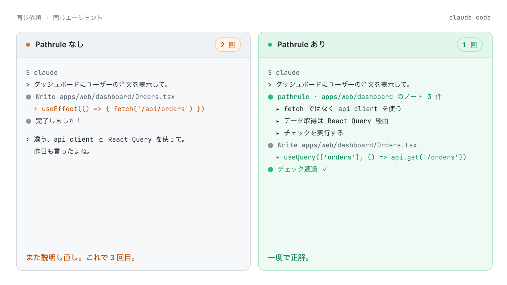
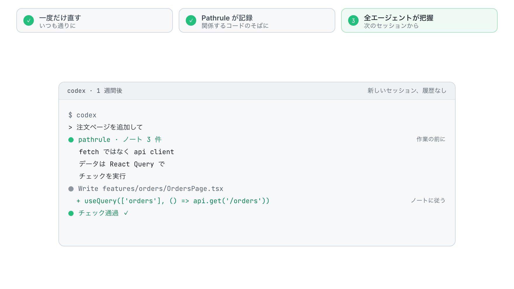
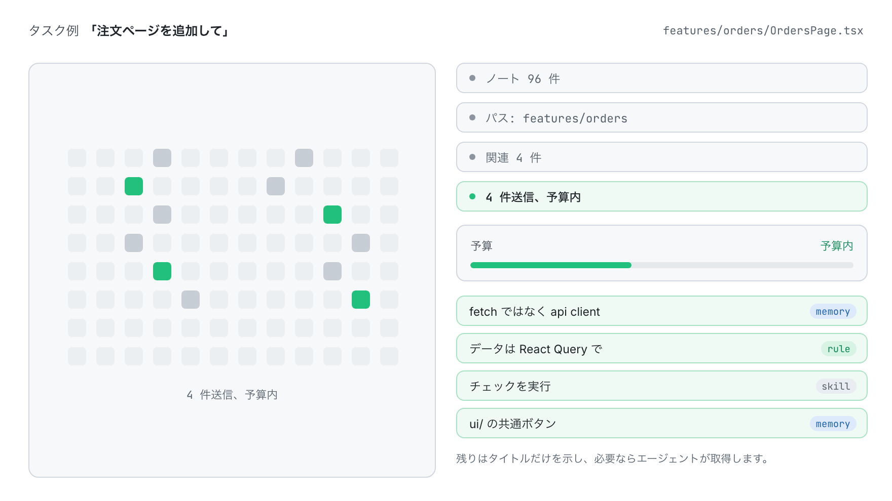
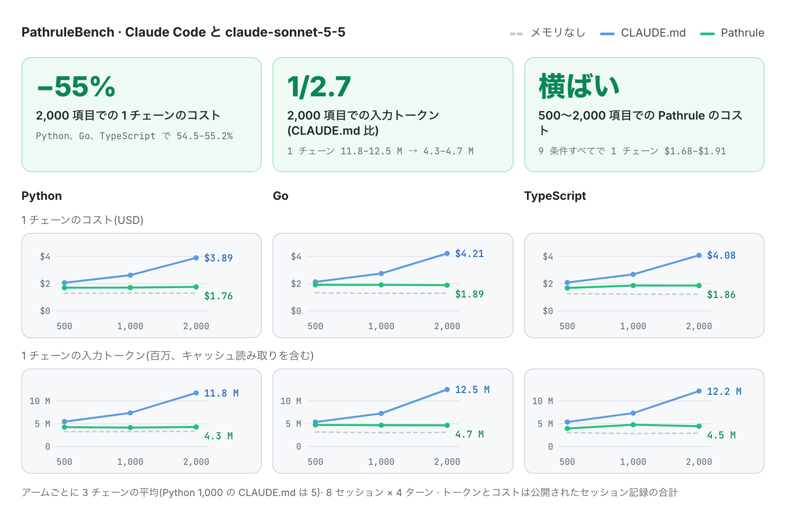
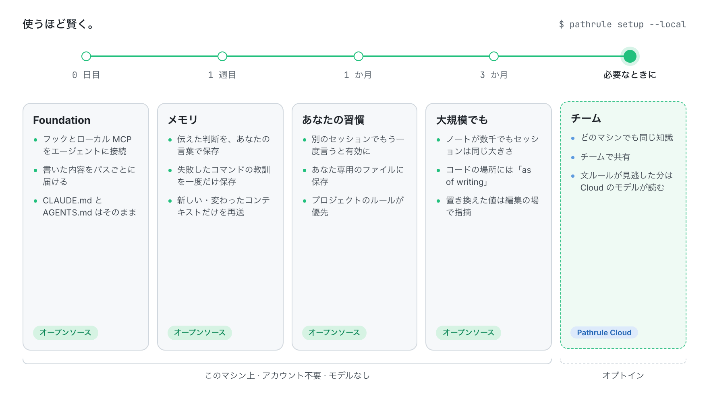
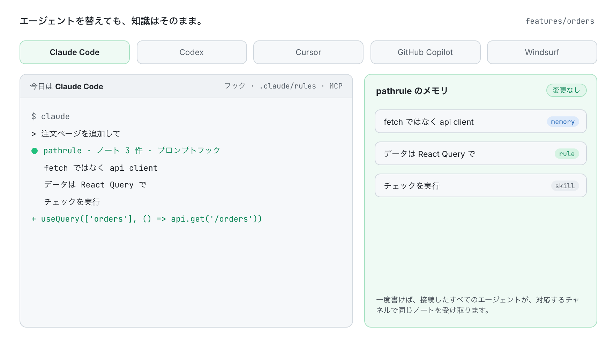

<p align="center">
  <picture>
    <source media="(prefers-color-scheme: dark)" srcset="docs/assets/pathrule-banner-dark.png">
    
  </picture>
</p>

<p align="center">
  <a href="README.md">English</a> · <a href="README.es.md">Español</a> · <a href="README.fr.md">Français</a> · <a href="README.de.md">Deutsch</a> · <b>日本語</b> · <a href="README.it.md">Italiano</a> · <a href="README.tr.md">Türkçe</a> · <a href="README.pt-BR.md">Português (Brasil)</a>
</p>

<p align="center"><sub>この翻訳は<a href="README.md">英語版 README</a> より古い場合があります。</sub></p>

<h3 align="center">AI は忘れる。Pathrule は覚えている。</h3>

<p align="center">
  コーディングエージェントのためのオープンソースのナレッジレイヤー。Pathrule はプロジェクトが学んだことを、コードのパスに紐づいたメモリ・ルール・スキルとして保持し、Claude Code、Codex、Cursor、GitHub Copilot、Windsurf に、いま取り組むタスクに必要なものだけを、動き出す前に渡します。
</p>

<p align="center">
  <a href="https://www.npmjs.com/package/@pathrule/cli"></a>
  <a href="LICENSE"></a>
  <a href="#benchmarks"></a>
  <a href="https://github.com/pathrule/pathrule/actions/workflows/ci.yml"></a>
  <a href="https://marketplace.visualstudio.com/items?itemName=Pathrule.pathrule-vscode"></a>
  <a href="https://open-vsx.org/extension/Pathrule/pathrule-vscode"></a>
</p>

<p align="center">
  <b>PathruleBench、2,000 項目：</b>1 チェーンのコスト 55% 減 · 入力トークン 1/2.7 · メモリプローブ通過率 97% · <a href="#benchmarks">数値を見る</a>
</p>

<p align="center">
  <a href="https://www.pathrule.io">Web サイト</a> · <a href="https://www.pathrule.io/docs/start/quickstart">ドキュメント</a> · <a href="#quickstart">クイックスタート</a> · <a href="#benchmarks">ベンチマーク</a> · <a href="#local-first">使うほど賢く</a> · <a href="https://www.pathrule.io/changelog">変更履歴</a>
</p>

<p align="center">
  <picture>
    <source media="(prefers-color-scheme: dark)" srcset="docs/assets/readme/ja/hero-dark.gif">
    
  </picture>
</p>

<p align="center"><sub><i>同じ依頼、同じエージェント。右側では、エージェントが 1 行書く前に、Pathrule のフックが <code>apps/web/dashboard</code> 用の 3 つのノートを渡しています。</i></sub></p>

<p align="center">
  <b>対応エージェント</b>  Claude Code · Codex · Cursor · GitHub Copilot · Windsurf · 任意の MCP クライアント
</p>

<a id="quickstart"></a>

## クイックスタート

Node.js 22.14.0 以降。macOS、Linux、Windows に対応しています。

```bash
npm i -g @pathrule/cli
pathrule setup --local    # アカウント不要:ナレッジはこのマシンに残ります
pathrule doctor           # 各エージェントが受け取る内容を確認
```

エージェントを再起動してください。次のセッションから、これから触るパスのノートを受け取り、作業しながら新しいノートも書いていきます。

| その他の始め方 | コマンド | 向いている用途 |
| --- | --- | --- |
| VS Code 拡張機能 | `code --install-extension Pathrule.pathrule-vscode` | コードの横でナレッジを確認。Marketplace と Open VSX。 |
| Claude Code / Codex プラグイン | `/plugin marketplace add pathrule/pathrule` · `codex plugin marketplace add pathrule/pathrule` | エージェントの中からインストール。セットアップは何かを変更する前にプランを表示します。 |
| Cursor プラグイン | Cursor Marketplace → Pathrule | Cursor の中で同じフック、MCP、スキル。 |
| Gemini CLI / OpenCode プラグイン | `gemini extensions install https://github.com/pathrule/gemini-cli-extension` · `opencode plugin @pathrule/opencode --global` | Gemini CLI と OpenCode で同じセットアップ。 |
| 任意の MCP クライアント | `npx -y @pathrule/mcp` | プラグイン機構のないエージェント向け。公式 MCP Registry に掲載。 |
| Local Console | `pathrule ui` | 127.0.0.1 でナレッジを閲覧・編集。アカウント不要。 |
| Remote MCP | `claude mcp add --transport http pathrule https://cloud.pathrule.io/mcp` | 何もインストールせずに試す。フックとローカルモードはありません。 |
| ソースから | `pnpm install && pnpm cli:bundle` | Pathrule の開発に参加する。[docs/quickstart.md](docs/quickstart.md) を参照。 |

<a id="explain-once"></a>

## 説明は一度だけ

コーディングエージェントは、毎回まっさらな状態でセッションを始めます。だから同じ指摘が、日を変え、エージェントを変えて、何度も繰り返されます：

| 曜日 | エージェント | あなたの入力 |  |
| --- | --- | --- | --- |
| 月 | Claude Code | 「fetch じゃなくて api client を使って」 | 1 回目 |
| 火 | Claude Code | 「また言うけど、fetch じゃなくて api client」 | 2 回目 |
| 水 | Codex | 「うちは api client を使ってる。」 | 3 回目 |
| 木 | Cursor | 「昨日言ったよね。api client。」 | 4 回目 |
| 金 | Claude Code | 「API CLIENT。FETCH じゃない。」 | 5 回目 |

5 回のセッション、3 つのエージェント、覚えていることはゼロ。Pathrule なら一度言えば済みます：

<p align="center">
  <picture>
    <source media="(prefers-color-scheme: dark)" srcset="docs/assets/readme/ja/explain-once-dark.gif">
    
  </picture>
</p>

1. **一度だけ直す**。いつも通りのやり方で。
2. **Pathrule が記録する**。関係するコードのそばに。毎セッション読まれるファイルに 1 行足すのではなく、`features/` のメモリとして。
3. **すべてのエージェントが把握する**。次のセッションから、どれを開いても。

<a id="how-it-works"></a>

## 必要なものだけ

ワークスペースには数百のノートがたまります。`features/orders` を編集するエージェントに必要なのは、そのうちの 4 つです。

<p align="center">
  <picture>
    <source media="(prefers-color-scheme: dark)" srcset="docs/assets/readme/ja/only-what-matters-dark.gif">
    
  </picture>
</p>

ナレッジはパス、スコープ、関連度で選ばれ、プロンプトごとの予算に収められます。強制ルールが容量不足で削られることはありません。収まらなかったものはタイトルだけが示され、エージェントは必要に応じて取得できます。プロンプトが関数や型の名前を挙げると、フックはそれが定義されているファイルと行もエージェントに示します(JS/TS、Python、Go)。

### 3 種類のナレッジ

| 種類 | 内容 | `features/` での例 |
| --- | --- | --- |
| **メモリ** | 判断、落とし穴、インシデントを短い Markdown で。 | 「api client を使う。認証とリトライを処理してくれる。」 |
| **ルール** | エージェントが守るべき制約。助言より優先されます。 | 「データ取得は React Query 経由。」 |
| **スキル** | エージェントが実行できる、再利用可能な手順とチェックリスト。 | 「完了とする前にチェックを実行する。」 |

### 3 つの経路

| チャネル | エージェントに届くタイミング | コスト |
| --- | --- | --- |
| パスごとのルールファイル | Claude Code はセッション開始時に Pathrule 専用の `.claude/rules/pathrule/` を読みます。各ファイルは担当するパスに限定されます。`CLAUDE.md` と `AGENTS.md` には手を加えません。 | クライアントがキャッシュ |
| フック | エージェントが動く前：セッション開始時、プロンプトごと、ファイル操作ツールの実行時。新しい・変わったコンテキストだけを再送します。 | プロンプトごとの予算内 |
| MCP `get_context` | エージェントが求めたときに、必要な深さで。 | すべての MCP クライアントで利用可能 |

<a id="benchmarks"></a>

## CLAUDE.md だけではだめな理由

<a href="https://github.com/pathrule/benchmark"></a>

**CLAUDE.md は毎ステップ全体が読まれるため、チームがノートを足すほど、すべてのセッションが高くつきます。Pathrule は、パスとタスクに必要なものだけを各プロンプトに届けます**。PathruleBench は、同じエージェント、同じプロンプト、同じ非公開チェックで、チームの知識 500〜2,000 項目にわたってこの差を測りました。

<p align="center">
  <picture>
    <source media="(prefers-color-scheme: dark)" srcset="docs/assets/readme/ja/bench-cost-tokens-dark.png">
    
  </picture>
</p>

<div align="center">

| チームの知識 2,000 項目で | CLAUDE.md | Pathrule |
| :-- | :-: | :-: |
| 1 チェーン(8 セッション)のコスト | $3.89–$4.21 | **$1.76–$1.89** |
| 1 チェーンの入力トークン | 11.8–12.5 M | **4.3–4.7 M** |
| メモリプローブの通過率 | 89% | **97%** |
| 全メモリプローブを通過したチェーン | 9 本中 0 本 | **9 本中 5 本** |
| 一度伝えた習慣が後で守られた割合 | 78% | **97%** |
| 失敗したコマンドの教訓が残った割合 | 33% | **78%** |
| 各プロンプトが求めた作業 | 100% | **100%** |

</div>

500 項目から 2,000 項目になると、CLAUDE.md の 1 チェーンのコストは 89〜98% 増えます。Pathrule では −1%〜+10% の範囲です。知識ベースは増えても、請求額は増えません。

<sub>Claude Code と claude-sonnet-5-5、Python・Go・TypeScript。2,000 項目ではアームごとに 9 チェーン(各言語 3 チェーン)。合否はすべて実行可能なテストが決め、判定にモデルは使いません。Pathrule アームはこのリポジトリのオープンソース CLI をローカルモードで使っています。Cloud もモデルも使っていません。</sub>

**[すべての条件・チェーン・チェックと、自分で実行する方法 → pathrule/benchmark](https://github.com/pathrule/benchmark)**

<a id="local-first"></a>

## 使うほど賢く。

初日はアカウントもネットワークもモデルも要りません。その後のすべては、あなたとエージェントがこのリポジトリですでに行ったことの上に積み上がります。

<p align="center">
  <picture>
    <source media="(prefers-color-scheme: dark)" srcset="docs/assets/readme/ja/over-time-dark.gif">
    
  </picture>
</p>

| 時期 | Pathrule がすること | 動作する場所 |
| --- | --- | --- |
| **0 日目**<br>Foundation | フックとローカル MCP サーバーがエージェントに接続されます。書いた内容はパスごとに予算内で、フックと Claude Code のパスごとのルールを通じて届けられます。あなたの `CLAUDE.md` と `AGENTS.md` には手を加えません。 | オープンソース、このマシン |
| **1 週目**<br>メモリ | プロンプトで伝えた判断(「今後は…」「…に決めた」)は、あなた自身の言葉で保存されます。失敗したコマンドが教えた教訓は一度だけ保存されます。各ノートは関係するコードのそばに置かれ、新しい・変わったコンテキストだけが再送されます。 | オープンソース、このマシン |
| **1 か月**<br>あなたの習慣 | 伝えた好みは、あなた専用のローカルファイルに残ります。作業中に一度言っただけなら保留され、別のセッションでもう一度言うと、すべてのエージェントに届きます。ずっと続けると言ったものはすぐに有効になります。プロジェクトのルールは常に個人の好みより優先されます。 | オープンソース、このマシン |
| **3 か月**<br>大規模でも | ノートが数千になっても、セッションの大きさは変わりません。ルートのルールファイルは約 6,000 文字のままで、残りはプロンプトごとに届きます。コードの場所を述べた文には `(as of writing)` が付くので、チームメイトがファイルを移しても、エージェントはコードに従います。新しい判断で置き換えられた値を編集が書き込もうとすると、フックがその編集の場でその判断を引用します。 | オープンソース、このマシン |
| **必要なときに**<br>チーム | 同じナレッジを、すべてのマシンとメンバーで。Cloud ワークスペースでは、Pathrule の文ルールが何も見つけなかったプロンプトもモデルが読み、続けてほしいと言った文を、あなたの言葉のまま保存します。費用は AI Credits から支払われます。 | Pathrule Cloud、オプトイン |

<sub>あなたのマシンでモデルは動きません。チームより前の段階はすべてオープンソース CLI で、上のベンチマークが測ったのと同じ経路です。</sub>

<a id="agents"></a>

## エージェントを替えても、知識はそのまま。

<p align="center">
  <picture>
    <source media="(prefers-color-scheme: dark)" srcset="docs/assets/readme/ja/any-agent-dark.gif">
    
  </picture>
</p>

| エージェント | 動く前 | 指示ファイル | MCP |
| --- | --- | --- | --- |
| Claude Code | フック(プロンプトフックを含む) | Pathrule 専用の `.claude/rules/pathrule/` | ローカルまたはリモート |
| Codex | フック(プロンプトフックを含む) | — | ローカルまたはリモート |
| Cursor | — | — | ローカル |
| GitHub Copilot | — | — | ローカル |
| Windsurf | — | — | ローカル |
| 任意の MCP クライアント | — | — | ローカルまたはリモート |

<a id="vs-rules-files"></a>

## もうひとつのルールファイルではない

|  | ルールファイル | Pathrule |
| --- | --- | --- |
| 書き方 | 手で書き、手で更新する | あなたとエージェントの作業とともに増える |
| 届く先 | ファイルごとに 1 つのツール | 接続したすべてのエージェント |
| 届け方 | 毎セッション、すべて | パスとタスクに必要なものだけ |
| 変更 | 誰かが編集したとき | バージョン管理され、新しい知識が古い知識を置き換える |

`CLAUDE.md` と `AGENTS.md` はそのまま使えます。Pathrule はそれらを編集しません。残りは 1 つのファイルでは届かないところへ、パスとタスクごとに届けます。

<a id="repository"></a>

## このリポジトリの中身

これは Pathrule のオープンソース基盤です。アカウントもネットワークサービスも不要で動きます：ストア、検索と順位付け、MCP サーバー、フック、学習ループ、CLI。

| 構成 | ここに含む | ライセンス |
| --- | --- | --- |
| **Foundation**：プロトコル、agent IR、ローカルのナレッジストア、ホスト、MCP サーバー、CLI、Pathrule Cloud クライアント、エージェント連携、Local Console、VS Code 拡張機能 | はい | Apache-2.0 |
| **Pathrule Cloud**：チームワークスペース、同期、Web コンソール、Remote MCP、Cloud のモデル層 | いいえ | プロプライエタリ |

<details>
<summary><b>11 のパッケージ</b></summary>

[`protocol`](packages/protocol) · [`agent-ir`](packages/agent-ir) · [`core`](packages/core) · [`integrations`](packages/integrations) · [`mcp`](packages/mcp) · [`host`](packages/host) · [`ui`](packages/ui) · [`local-console`](packages/local-console) · [`cloud`](packages/cloud) · [`cli`](packages/cli) · [`vscode`](packages/vscode)

</details>

```bash
pnpm install
pnpm typecheck      # 全パッケージ
pnpm test           # 各パッケージのテスト
pnpm build          # 各パッケージの npm ビルド
```

<a id="privacy"></a>

## あなたのコードはあなたのもの

- ソースコードが自動でアップロードされることはありません。
- ローカルモードはアカウント不要でモデルも動かさず、オープンな CLI はテレメトリを送信しません。
- エージェントは自分のモデルプロバイダーをそのまま使います。Pathrule はモデルでも、エージェントでも、IDE でもありません。
- Pathrule Cloud はオプトインです。サインインすると、ナレッジを保存し、プロンプトを使って順位付けします。また、そのモデル層が、続けるつもりの判断を見つけるためにプロンプトを読むことがあります。

<a id="community"></a>

## コミュニティ

<a href="https://star-history.com/#pathrule/pathrule&Date">
  <picture>
    <source media="(prefers-color-scheme: dark)" srcset="https://api.star-history.com/svg?repos=pathrule/pathrule&type=Date&theme=dark">
    
  </picture>
</a>

### コントリビューター

<a href="https://github.com/pathrule/pathrule/graphs/contributors">
  
</a>

[コントリビュート](CONTRIBUTING.md)(DCO 署名) · [行動規範](CODE_OF_CONDUCT.md) · [脆弱性の報告](SECURITY.md) · [サポート](SUPPORT.md) · [商標ポリシー](TRADEMARKS.md)

<a id="license"></a>

## ライセンス

Apache-2.0。[LICENSE](LICENSE) と [NOTICE](NOTICE) を参照してください。Pathrule の名称とロゴは Apache-2.0 ではライセンスされていません。

<p align="center">
  <a href="https://www.pathrule.io">pathrule.io</a> · <a href="https://www.pathrule.io/docs">ドキュメント</a> · <a href="https://www.pathrule.io/products/cloud">Pathrule Cloud</a>
</p>
