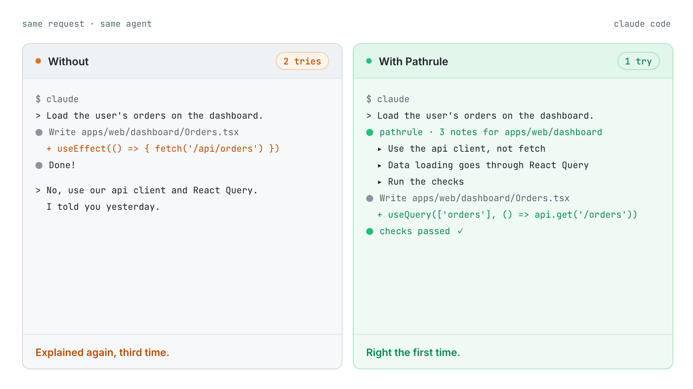
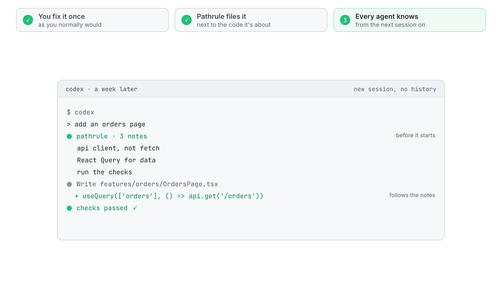
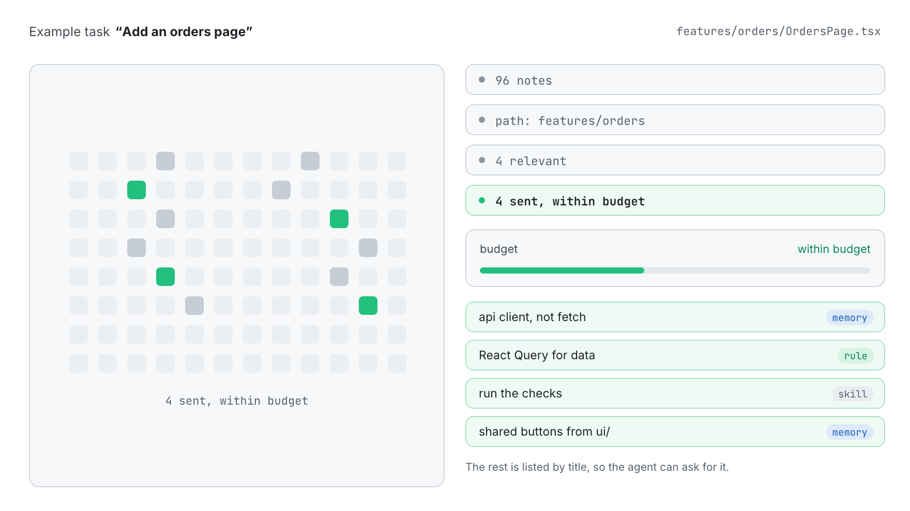
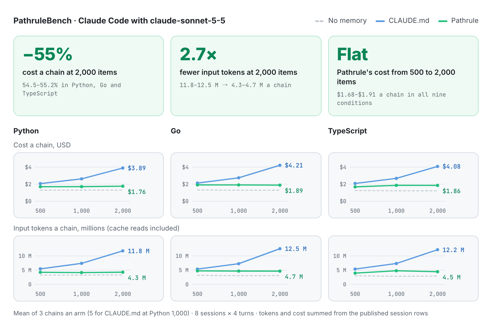
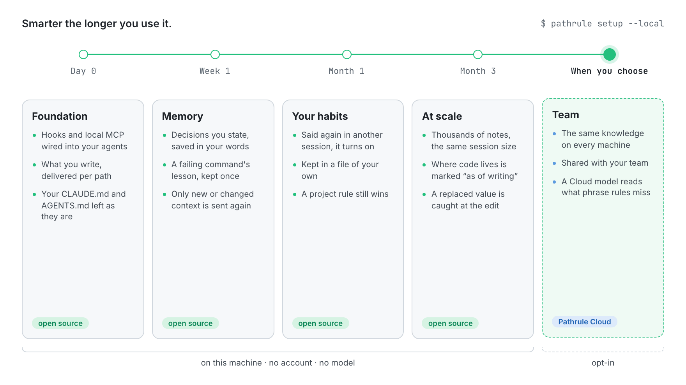
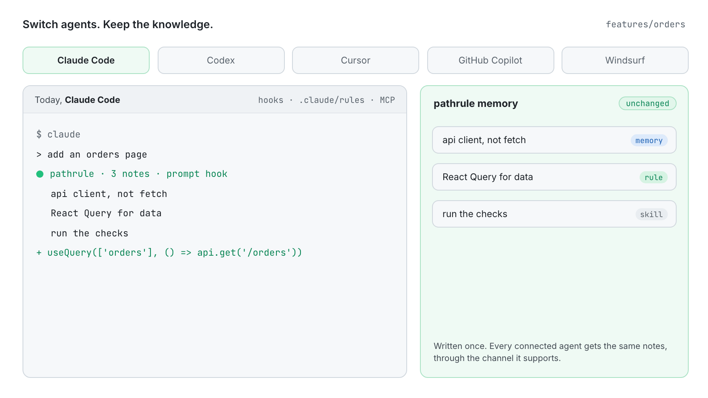

<p align="center">
  <picture>
    <source media="(prefers-color-scheme: dark)" srcset="docs/assets/pathrule-banner-dark.png">
    
  </picture>
</p>

<p align="center">
  <b>English</b> · <a href="README.es.md">Español</a> · <a href="README.fr.md">Français</a> · <a href="README.de.md">Deutsch</a> · <a href="README.ja.md">日本語</a> · <a href="README.it.md">Italiano</a> · <a href="README.tr.md">Türkçe</a> · <a href="README.pt-BR.md">Português (Brasil)</a>
</p>

<h3 align="center">Your AI forgets. Pathrule remembers.</h3>

<p align="center">
  The open-source knowledge layer for coding agents. Pathrule keeps what your project has learned as memories, rules and skills scoped to paths in your code, and gives Claude Code, Codex, Cursor, GitHub Copilot and Windsurf only what the task in front of them needs, before they act.
</p>

<p align="center">
  <a href="https://www.npmjs.com/package/@pathrule/cli"></a>
  <a href="LICENSE"></a>
  <a href="#benchmarks"></a>
  <a href="https://github.com/pathrule/pathrule/actions/workflows/ci.yml"></a>
  <a href="https://marketplace.visualstudio.com/items?itemName=Pathrule.pathrule-vscode"></a>
  <a href="https://open-vsx.org/extension/Pathrule/pathrule-vscode"></a>
</p>

<p align="center">
  <b>PathruleBench, 2,000 items:</b> 55% lower cost a chain · 2.7× fewer input tokens · 97% of memory probes passed · <a href="#benchmarks">the numbers</a>
</p>

<p align="center">
  <a href="https://www.pathrule.io">Website</a> · <a href="https://www.pathrule.io/docs/start/quickstart">Docs</a> · <a href="#quickstart">Quickstart</a> · <a href="#benchmarks">Benchmarks</a> · <a href="#local-first">Smarter over time</a> · <a href="https://www.pathrule.io/changelog">Changelog</a>
</p>

<p align="center">
  <picture>
    <source media="(prefers-color-scheme: dark)" srcset="docs/assets/readme/en/hero-dark.gif">
    
  </picture>
</p>

<p align="center"><sub><i>Same request, same agent. On the right, Pathrule's hook hands over the three notes filed for <code>apps/web/dashboard</code> before the agent writes a line.</i></sub></p>

<p align="center">
  <b>Works with</b>  Claude Code · Codex · Cursor · GitHub Copilot · Windsurf · any MCP client
</p>

<a id="quickstart"></a>

## Quickstart

Node.js 22.14.0 or newer, on macOS, Linux or Windows.

```bash
npm i -g @pathrule/cli
pathrule setup --local    # no account: knowledge stays on this machine
pathrule doctor           # see what each agent receives
```

Restart your agent. From the next session on, it gets the notes for the path it is about to touch, and writes new ones as it works.

| Other ways in | Command | Good for |
| --- | --- | --- |
| VS Code extension | `code --install-extension Pathrule.pathrule-vscode` | Knowledge beside the code. Marketplace and Open VSX. |
| Claude Code / Codex plugin | `/plugin marketplace add pathrule/pathrule` · `codex plugin marketplace add pathrule/pathrule` | Installing from inside the agent. Setup shows a plan before it changes anything. |
| Cursor plugin | Cursor Marketplace → Pathrule | The same hooks, MCP and skills inside Cursor. |
| Gemini CLI / OpenCode plugin | `gemini extensions install https://github.com/pathrule/gemini-cli-extension` · `opencode plugin @pathrule/opencode --global` | The same setup in Gemini CLI and OpenCode. |
| Any MCP client | `npx -y @pathrule/mcp` | Agents without a plugin system. Listed in the official MCP Registry. |
| Local Console | `pathrule ui` | Browse and edit knowledge on 127.0.0.1. No account. |
| Remote MCP | `claude mcp add --transport http pathrule https://cloud.pathrule.io/mcp` | Trying it with nothing installed. No hooks, no local mode. |
| From source | `pnpm install && pnpm cli:bundle` | Hacking on Pathrule. See [docs/quickstart.md](docs/quickstart.md). |

<a id="explain-once"></a>

## Explain it once

Coding agents start every session blank. So the same correction comes back, day after day, agent after agent:

| Day | Agent | What you typed |  |
| --- | --- | --- | --- |
| Mon | Claude Code | “use our api client, not fetch” | 1st |
| Tue | Claude Code | “again: api client, not fetch” | 2nd |
| Wed | Codex | “we use the api client.” | 3rd |
| Thu | Cursor | “I told you yesterday. api client.” | 4th |
| Fri | Claude Code | “API CLIENT. NOT FETCH.” | 5th |

Five sessions, three agents, nothing remembered. With Pathrule you say it once:

<p align="center">
  <picture>
    <source media="(prefers-color-scheme: dark)" srcset="docs/assets/readme/en/explain-once-dark.gif">
    
  </picture>
</p>

1. **You fix it once**, the way you normally would.
2. **Pathrule files it** next to the code it is about: a memory on `features/`, not a line in a file every session has to read.
3. **Every agent knows** from the next session on, whichever one you open.

<a id="how-it-works"></a>

## Only what matters

A workspace collects hundreds of notes. An agent editing `features/orders` needs four of them.

<p align="center">
  <picture>
    <source media="(prefers-color-scheme: dark)" srcset="docs/assets/readme/en/only-what-matters-dark.gif">
    
  </picture>
</p>

Knowledge is matched by path, scope and relevance, then fit to a per-prompt budget. Enforced rules are never cut for space. Whatever does not fit is listed by title, so the agent can ask for it. When a prompt names a function or a type, the hook also points the agent to the file and line where it is defined (JS/TS, Python, Go).

### Three kinds of knowledge

| Kind | What it holds | Example on `features/` |
| --- | --- | --- |
| **Memory** | Decisions, gotchas and incidents, in short markdown. | “Use the api client. It handles auth and retries.” |
| **Rule** | Constraints the agent must follow, ranked above advice. | “Data loading goes through React Query.” |
| **Skill** | Reusable procedures and checklists an agent can run. | “Run the checks before calling it done.” |

### Three ways in

| Channel | When it reaches the agent | Cost |
| --- | --- | --- |
| Path-scoped rule files | Claude Code reads Pathrule's own `.claude/rules/pathrule/` at session start, each file scoped to its paths. Your `CLAUDE.md` and `AGENTS.md` are left as they are. | Cached by the client. |
| Hooks | Before the agent acts: on session start, on each prompt and on file tools. Only new or changed context is sent again. | Budgeted per prompt. |
| MCP `get_context` | When the agent asks, at the depth the request needs. | Every MCP client has it. |

<a id="benchmarks"></a>

## Why not just CLAUDE.md?

<a href="https://github.com/pathrule/benchmark"></a>

**A CLAUDE.md file is read whole on every step, so every note your team adds makes every session cost more. Pathrule sends each prompt only what the path and the task need.** PathruleBench measured the difference with the same agent, the same prompts and the same hidden checks, from 500 to 2,000 items of team knowledge.

<p align="center">
  <picture>
    <source media="(prefers-color-scheme: dark)" srcset="docs/assets/readme/en/bench-cost-tokens-dark.png">
    
  </picture>
</p>

<div align="center">

| At 2,000 items of team knowledge | CLAUDE.md | Pathrule |
| :-- | :-: | :-: |
| Cost a chain of 8 sessions | $3.89–$4.21 | **$1.76–$1.89** |
| Input tokens a chain | 11.8–12.5 M | **4.3–4.7 M** |
| Memory probes passed | 89% | **97%** |
| Chains that passed every memory probe | 0 of 9 | **5 of 9** |
| A habit said once, followed later | 78% | **97%** |
| What a failing command taught, kept | 33% | **78%** |
| The work each prompt asked for | 100% | **100%** |

</div>

From 500 to 2,000 items, a chain with CLAUDE.md costs 89–98% more. With Pathrule it moves between −1% and +10%. Your knowledge base can grow; the bill does not.

<sub>Claude Code with claude-sonnet-5-5 in Python, Go and TypeScript; nine chains an arm at 2,000 items (three per language); executable tests decide every pass, no model judges. The Pathrule arm is this repository's open-source CLI in local mode: no Cloud, no model.</sub>

**[Every condition, chain and check, and how to run it yourself → pathrule/benchmark](https://github.com/pathrule/benchmark)**

<a id="local-first"></a>

## Smarter the longer you use it.

Day one needs no account, no network and no model. Everything after builds on what you and your agents already did in this repository.

<p align="center">
  <picture>
    <source media="(prefers-color-scheme: dark)" srcset="docs/assets/readme/en/over-time-dark.gif">
    
  </picture>
</p>

| When | What Pathrule does | Where it runs |
| --- | --- | --- |
| **Day 0**<br>Foundation | Hooks and the local MCP server are wired into your agents. What you write is delivered per path, within a budget, through the hooks and Claude Code's path-scoped rules; your own `CLAUDE.md` and `AGENTS.md` are left as they are. | Open source, this machine |
| **Week 1**<br>Memory | A decision you state in a prompt (“from now on…”, “we decided…”) is saved in your own words. A lesson a failing command taught is saved once. Each note is filed next to the code it is about, and only new or changed context is sent again. | Open source, this machine |
| **Month 1**<br>Your habits | A preference you state lives in a local file of your own. Said once in passing, it waits; said again in another session, it reaches every agent. One you call lasting is in force at once. A project rule always wins over a personal one. | Open source, this machine |
| **Month 3**<br>At scale | Thousands of notes, and a session stays the same size: the root rules file stays around 6k characters and the rest arrives per prompt. A sentence that says where code lives is marked `(as of writing)`, so when a teammate moves the file the agent follows the code. When an edit writes a value a newer decision replaced, the hook quotes the decision at that edit. | Open source, this machine |
| **When you choose**<br>Team | The same knowledge on every machine and for every member. For a Cloud workspace, a model also reads the prompts Pathrule's phrase rules found nothing in and keeps the sentence you meant to last, still in your words. It is paid from AI Credits. | Pathrule Cloud, opt-in |

<sub>No model runs on your machine. Everything before Team is the open-source CLI, the same path the benchmark above measured.</sub>

<a id="agents"></a>

## Switch agents. Keep the knowledge.

<p align="center">
  <picture>
    <source media="(prefers-color-scheme: dark)" srcset="docs/assets/readme/en/any-agent-dark.gif">
    
  </picture>
</p>

| Agent | Before it acts | Instruction file | MCP |
| --- | --- | --- | --- |
| Claude Code | Hooks, prompt hook included | Pathrule's own `.claude/rules/pathrule/` | Local or Remote |
| Codex | Hooks, prompt hook included | — | Local or Remote |
| Cursor | — | — | Local |
| GitHub Copilot | — | — | Local |
| Windsurf | — | — | Local |
| Any MCP client | — | — | Local or Remote |

<a id="vs-rules-files"></a>

## Not another rules file

|  | A rules file | Pathrule |
| --- | --- | --- |
| Written | By hand, kept current by hand | Grows as you and your agents work |
| Reaches | One tool per file | Every connected agent |
| Delivered | All of it, every session | Only what the path and the task need |
| Changes | When someone edits it | Versioned; new knowledge replaces old |

Keep your `CLAUDE.md` and `AGENTS.md`: Pathrule does not edit them. It delivers the rest per path and per task, where a single file cannot.

<a id="repository"></a>

## What's in this repository

This is Pathrule's open-source foundation. It runs with no account and no network service: the store, retrieval and ranking, the MCP server, the hooks, the learning loop and the CLI.

| Part | Here | Licence |
| --- | --- | --- |
| **Foundation**: protocol, agent IR, the local knowledge store, host, MCP server, CLI, Pathrule Cloud client, agent integrations, Local Console, VS Code extension | Yes | Apache-2.0 |
| **Pathrule Cloud**: team workspaces, sync, the web console, Remote MCP, the Cloud model tier | No | Proprietary |

<details>
<summary><b>The 11 packages</b></summary>

[`protocol`](packages/protocol) · [`agent-ir`](packages/agent-ir) · [`core`](packages/core) · [`integrations`](packages/integrations) · [`mcp`](packages/mcp) · [`host`](packages/host) · [`ui`](packages/ui) · [`local-console`](packages/local-console) · [`cloud`](packages/cloud) · [`cli`](packages/cli) · [`vscode`](packages/vscode)

</details>

```bash
pnpm install
pnpm typecheck      # every package
pnpm test           # every package's tests
pnpm build          # each package's npm build
```

<a id="privacy"></a>

## Your code stays yours

- Source code is never uploaded automatically.
- Local mode has no account, runs no model, and the open CLI sends no telemetry.
- Your agent keeps its own model provider. Pathrule is not a model, an agent or an IDE.
- Pathrule Cloud is opt-in. Signed in, it stores your knowledge and uses the prompt to rank it, and its model tier may read a prompt to find a decision meant to last.

<a id="community"></a>

## Community

<a href="https://star-history.com/#pathrule/pathrule&Date">
  <picture>
    <source media="(prefers-color-scheme: dark)" srcset="https://api.star-history.com/svg?repos=pathrule/pathrule&type=Date&theme=dark">
    
  </picture>
</a>

### Contributors

<a href="https://github.com/pathrule/pathrule/graphs/contributors">
  
</a>

[Contributing](CONTRIBUTING.md) (DCO sign-off) · [Code of conduct](CODE_OF_CONDUCT.md) · [Report a vulnerability](SECURITY.md) · [Get help](SUPPORT.md) · [Trademark policy](TRADEMARKS.md)

<a id="license"></a>

## License

Apache-2.0. See [LICENSE](LICENSE) and [NOTICE](NOTICE). The Pathrule name and logo are not licensed under Apache-2.0.

<p align="center">
  <a href="https://www.pathrule.io">pathrule.io</a> · <a href="https://www.pathrule.io/docs">Docs</a> · <a href="https://www.pathrule.io/products/cloud">Pathrule Cloud</a>
</p>
