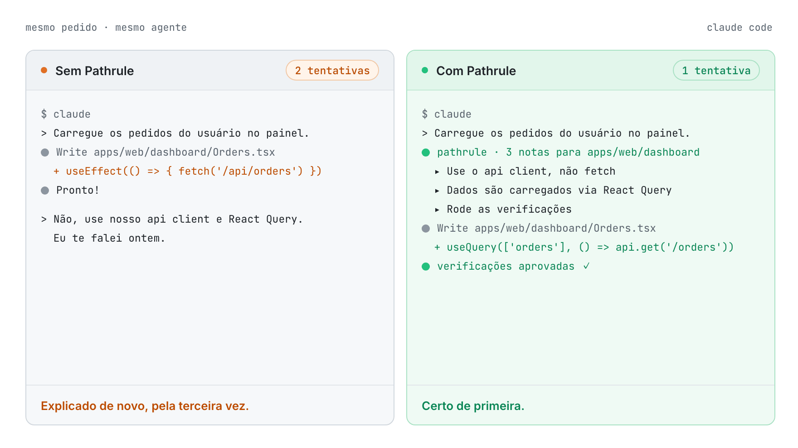
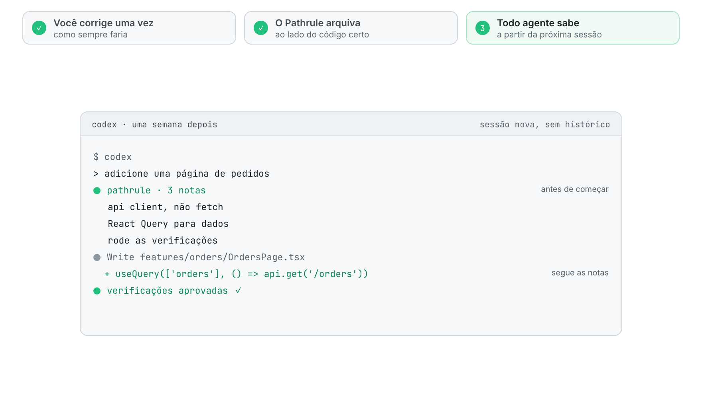
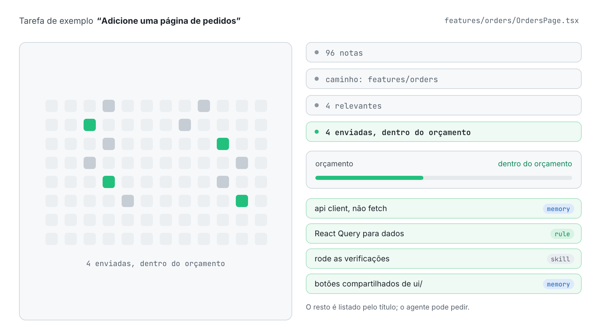
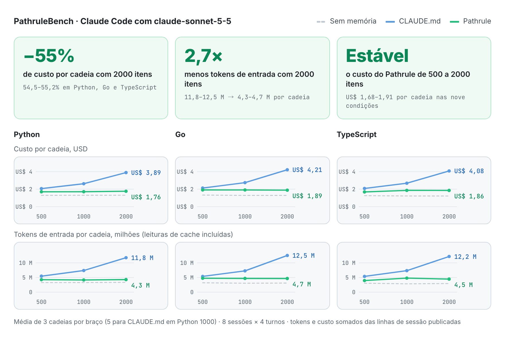
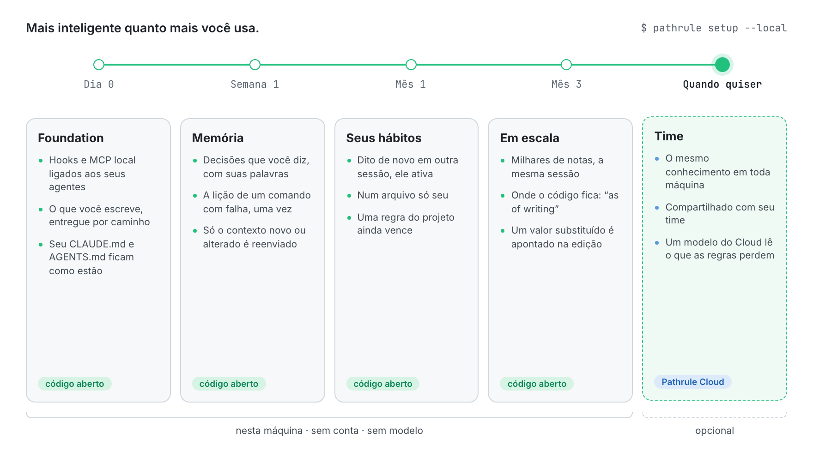
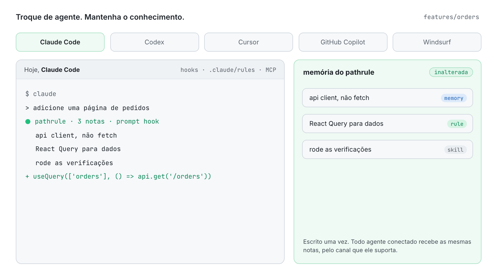

<p align="center">
  <picture>
    <source media="(prefers-color-scheme: dark)" srcset="docs/assets/pathrule-banner-dark.png">
    
  </picture>
</p>

<p align="center">
  <a href="README.md">English</a> · <a href="README.es.md">Español</a> · <a href="README.fr.md">Français</a> · <a href="README.de.md">Deutsch</a> · <a href="README.ja.md">日本語</a> · <a href="README.it.md">Italiano</a> · <a href="README.tr.md">Türkçe</a> · <b>Português (Brasil)</b>
</p>

<p align="center"><sub>Esta tradução pode estar atrás do <a href="README.md">README em inglês</a>.</sub></p>

<h3 align="center">Sua IA esquece. O Pathrule lembra.</h3>

<p align="center">
  A camada de conhecimento open source para agentes de programação. O Pathrule guarda o que seu projeto aprendeu como memórias, regras e skills ligadas aos caminhos do seu código, e entrega ao Claude Code, Codex, Cursor, GitHub Copilot e Windsurf só o que a tarefa à frente precisa, antes de eles agirem.
</p>

<p align="center">
  <a href="https://www.npmjs.com/package/@pathrule/cli"></a>
  <a href="LICENSE"></a>
  <a href="#benchmarks"></a>
  <a href="https://github.com/pathrule/pathrule/actions/workflows/ci.yml"></a>
  <a href="https://marketplace.visualstudio.com/items?itemName=Pathrule.pathrule-vscode"></a>
  <a href="https://open-vsx.org/extension/Pathrule/pathrule-vscode"></a>
</p>

<p align="center">
  <b>PathruleBench, 2000 itens:</b> 55% menos custo por cadeia · 2,7× menos tokens de entrada · 97% das sondas de memória aprovadas · <a href="#benchmarks">os números</a>
</p>

<p align="center">
  <a href="https://www.pathrule.io">Site</a> · <a href="https://www.pathrule.io/docs/start/quickstart">Documentação</a> · <a href="#quickstart">Início rápido</a> · <a href="#benchmarks">Benchmarks</a> · <a href="#local-first">Mais inteligente com o tempo</a> · <a href="https://www.pathrule.io/changelog">Changelog</a>
</p>

<p align="center">
  <picture>
    <source media="(prefers-color-scheme: dark)" srcset="docs/assets/readme/pt-BR/hero-dark.gif">
    
  </picture>
</p>

<p align="center"><sub><i>Mesmo pedido, mesmo agente. À direita, o hook do Pathrule entrega as três notas arquivadas para <code>apps/web/dashboard</code> antes de o agente escrever uma linha.</i></sub></p>

<p align="center">
  <b>Funciona com</b>  Claude Code · Codex · Cursor · GitHub Copilot · Windsurf · qualquer cliente MCP
</p>

<a id="quickstart"></a>

## Início rápido

Node.js 22.14.0 ou mais recente, no macOS, Linux ou Windows.

```bash
npm i -g @pathrule/cli
pathrule setup --local    # sem conta: o conhecimento fica nesta máquina
pathrule doctor           # veja o que cada agente recebe
```

Reinicie seu agente. A partir da próxima sessão, ele recebe as notas do caminho que vai mexer, e escreve novas enquanto trabalha.

| Outras formas de começar | Comando | Bom para |
| --- | --- | --- |
| Extensão do VS Code | `code --install-extension Pathrule.pathrule-vscode` | Conhecimento ao lado do código. Marketplace e Open VSX. |
| Plugin do Claude Code / Codex | `/plugin marketplace add pathrule/pathrule` · `codex plugin marketplace add pathrule/pathrule` | Instalar de dentro do agente. A configuração mostra um plano antes de mudar qualquer coisa. |
| Plugin do Cursor | Cursor Marketplace → Pathrule | Os mesmos hooks, MCP e skills dentro do Cursor. |
| Plugin do Gemini CLI / OpenCode | `gemini extensions install https://github.com/pathrule/gemini-cli-extension` · `opencode plugin @pathrule/opencode --global` | A mesma configuração no Gemini CLI e no OpenCode. |
| Qualquer cliente MCP | `npx -y @pathrule/mcp` | Agentes sem sistema de plugins. Listado no MCP Registry oficial. |
| Local Console | `pathrule ui` | Navegar e editar o conhecimento em 127.0.0.1. Sem conta. |
| Remote MCP | `claude mcp add --transport http pathrule https://cloud.pathrule.io/mcp` | Testar sem instalar nada. Sem hooks, sem modo local. |
| A partir do código-fonte | `pnpm install && pnpm cli:bundle` | Contribuir com o Pathrule. Veja [docs/quickstart.md](docs/quickstart.md). |

<a id="explain-once"></a>

## Explique uma vez

Agentes de programação começam toda sessão do zero. Então a mesma correção volta, dia após dia, agente após agente:

| Dia | Agente | O que você digitou |  |
| --- | --- | --- | --- |
| Seg | Claude Code | “use nosso api client, não fetch” | 1ª |
| Ter | Claude Code | “de novo: api client, não fetch” | 2ª |
| Qua | Codex | “a gente usa o api client.” | 3ª |
| Qui | Cursor | “Eu te falei ontem. api client.” | 4ª |
| Sex | Claude Code | “API CLIENT. NÃO FETCH.” | 5ª |

Cinco sessões, três agentes, nada lembrado. Com o Pathrule, você diz uma vez:

<p align="center">
  <picture>
    <source media="(prefers-color-scheme: dark)" srcset="docs/assets/readme/pt-BR/explain-once-dark.gif">
    
  </picture>
</p>

1. **Você corrige uma vez**, como sempre faria.
2. **O Pathrule arquiva** ao lado do código a que se refere: uma memória em `features/`, não mais uma linha num arquivo que toda sessão precisa ler.
3. **Todo agente sabe** a partir da próxima sessão, seja qual for o que você abrir.

<a id="how-it-works"></a>

## Só o que importa

Um workspace acumula centenas de notas. Um agente editando `features/orders` precisa de quatro.

<p align="center">
  <picture>
    <source media="(prefers-color-scheme: dark)" srcset="docs/assets/readme/pt-BR/only-what-matters-dark.gif">
    
  </picture>
</p>

O conhecimento é escolhido por caminho, escopo e relevância, e depois encaixado num orçamento por prompt. Regras obrigatórias nunca são cortadas por falta de espaço. O que não cabe é listado pelo título, para que o agente possa pedir. Quando um prompt cita uma função ou um tipo, o hook também mostra ao agente o arquivo e a linha onde ele é definido (JS/TS, Python, Go).

### Três tipos de conhecimento

| Tipo | O que guarda | Exemplo em `features/` |
| --- | --- | --- |
| **Memória** | Decisões, armadilhas e incidentes, em markdown curto. | “Use o api client. Ele cuida da autenticação e das novas tentativas.” |
| **Regra** | Restrições que o agente precisa seguir, acima dos conselhos. | “O carregamento de dados passa pelo React Query.” |
| **Skill** | Procedimentos e checklists reutilizáveis que um agente pode executar. | “Rode as verificações antes de dar como pronto.” |

### Três caminhos de entrada

| Canal | Quando chega ao agente | Custo |
| --- | --- | --- |
| Arquivos de regras por caminho | Ao iniciar a sessão, o Claude Code lê a pasta própria do Pathrule, `.claude/rules/pathrule/`, cada arquivo restrito aos seus caminhos. Seu `CLAUDE.md` e seu `AGENTS.md` ficam como estão. | Cache do cliente. |
| Hooks | Antes de o agente agir: no início da sessão, a cada prompt e nas ferramentas de arquivo. Só o contexto novo ou alterado é reenviado. | Com orçamento por prompt. |
| MCP `get_context` | Quando o agente pede, na profundidade que o pedido precisa. | Disponível em todo cliente MCP. |

<a id="benchmarks"></a>

## Por que não só o CLAUDE.md?

<a href="https://github.com/pathrule/benchmark"></a>

**Um arquivo CLAUDE.md é lido inteiro a cada passo, então cada nota que o seu time adiciona deixa cada sessão mais cara. O Pathrule envia a cada prompt só o que o caminho e a tarefa precisam.** O PathruleBench mediu a diferença com o mesmo agente, os mesmos prompts e as mesmas verificações ocultas, de 500 a 2000 itens de conhecimento do time.

<p align="center">
  <picture>
    <source media="(prefers-color-scheme: dark)" srcset="docs/assets/readme/pt-BR/bench-cost-tokens-dark.png">
    
  </picture>
</p>

<div align="center">

| Com 2000 itens de conhecimento | CLAUDE.md | Pathrule |
| :-- | :-: | :-: |
| Custo de uma cadeia de 8 sessões | US$ 3,89–4,21 | **US$ 1,76–1,89** |
| Tokens de entrada por cadeia | 11,8–12,5 M | **4,3–4,7 M** |
| Sondas de memória aprovadas | 89% | **97%** |
| Cadeias que passaram em todas as sondas | 0 de 9 | **5 de 9** |
| Um hábito dito uma vez, seguido depois | 78% | **97%** |
| O que um comando com falha ensinou, mantido | 33% | **78%** |
| O trabalho que cada prompt pediu | 100% | **100%** |

</div>

De 500 para 2000 itens, uma cadeia com o CLAUDE.md custa de 89% a 98% a mais. Com o Pathrule, a variação fica entre −1% e +10%. Sua base de conhecimento pode crescer; a conta, não.

<sub>Claude Code com claude-sonnet-5-5 em Python, Go e TypeScript; nove cadeias por braço com 2000 itens (três por linguagem); testes executáveis decidem cada aprovação, nenhum modelo julga. O braço do Pathrule é a CLI open source deste repositório em modo local: sem Cloud, sem modelo.</sub>

**[Cada condição, cadeia e verificação, e como rodar você mesmo → pathrule/benchmark](https://github.com/pathrule/benchmark)**

<a id="local-first"></a>

## Mais inteligente quanto mais você usa.

O primeiro dia não precisa de conta, de rede nem de modelo. Tudo o que vem depois se apoia no que você e seus agentes já fizeram neste repositório.

<p align="center">
  <picture>
    <source media="(prefers-color-scheme: dark)" srcset="docs/assets/readme/pt-BR/over-time-dark.gif">
    
  </picture>
</p>

| Quando | O que o Pathrule faz | Onde roda |
| --- | --- | --- |
| **Dia 0**<br>Foundation | Os hooks e o servidor MCP local são ligados aos seus agentes. O que você escreve é entregue por caminho, dentro de um orçamento, pelos hooks e pelas regras por caminho do Claude Code; seu `CLAUDE.md` e seu `AGENTS.md` ficam como estão. | Código aberto, esta máquina |
| **Semana 1**<br>Memória | Uma decisão que você diz num prompt (“daqui pra frente…”, “decidimos…”) é salva com as suas palavras. Uma lição que um comando com falha ensinou é salva uma vez. Cada nota é arquivada ao lado do código a que se refere, e só o contexto novo ou alterado é reenviado. | Código aberto, esta máquina |
| **Mês 1**<br>Seus hábitos | Uma preferência que você expressa fica num arquivo local só seu. Dita uma vez de passagem, ela espera; dita de novo em outra sessão, chega a todos os agentes. A que você declara duradoura vale na hora. Uma regra do projeto sempre vence uma pessoal. | Código aberto, esta máquina |
| **Mês 3**<br>Em escala | Milhares de notas, e a sessão continua do mesmo tamanho: o arquivo de regras raiz fica em torno de 6000 caracteres e o resto chega por prompt. Uma frase que diz onde o código fica é marcada com `(as of writing)`; quando um colega move o arquivo, o agente segue o código. Quando uma edição escreve um valor que uma decisão mais nova substituiu, o hook cita a decisão ali mesmo. | Código aberto, esta máquina |
| **Quando quiser**<br>Time | O mesmo conhecimento em toda máquina e para cada membro. Num workspace do Cloud, um modelo também lê os prompts em que as regras de frases do Pathrule não encontraram nada e guarda a frase que você queria que durasse, com as suas palavras. É pago com AI Credits. | Pathrule Cloud, opcional |

<sub>Nenhum modelo roda na sua máquina. Tudo antes de Time é a CLI open source, o mesmo caminho que o benchmark acima mediu.</sub>

<a id="agents"></a>

## Troque de agente. Mantenha o conhecimento.

<p align="center">
  <picture>
    <source media="(prefers-color-scheme: dark)" srcset="docs/assets/readme/pt-BR/any-agent-dark.gif">
    
  </picture>
</p>

| Agente | Antes de agir | Arquivo de instruções | MCP |
| --- | --- | --- | --- |
| Claude Code | Hooks, incluindo o de prompt | A pasta própria do Pathrule, `.claude/rules/pathrule/` | Local ou remoto |
| Codex | Hooks, incluindo o de prompt | — | Local ou remoto |
| Cursor | — | — | Local |
| GitHub Copilot | — | — | Local |
| Windsurf | — | — | Local |
| Qualquer cliente MCP | — | — | Local ou remoto |

<a id="vs-rules-files"></a>

## Não é mais um arquivo de regras

|  | Um arquivo de regras | Pathrule |
| --- | --- | --- |
| Escrito | À mão, atualizado à mão | Cresce enquanto você e seus agentes trabalham |
| Alcança | Uma ferramenta por arquivo | Todo agente conectado |
| Entregue | Tudo, em toda sessão | Só o que o caminho e a tarefa precisam |
| Muda | Quando alguém edita | Versionado; conhecimento novo substitui o antigo |

Mantenha seu `CLAUDE.md` e seu `AGENTS.md`: o Pathrule não os edita. Ele entrega o resto por caminho e por tarefa, onde um único arquivo não chega.

<a id="repository"></a>

## O que há neste repositório

Esta é a base open source do Pathrule. Funciona sem conta e sem serviço de rede: o armazenamento, a busca e o ranking, o servidor MCP, os hooks, o ciclo de aprendizado e a CLI.

| Parte | Aqui | Licença |
| --- | --- | --- |
| **Foundation**: protocolo, agent IR, armazenamento local de conhecimento, host, servidor MCP, CLI, cliente do Pathrule Cloud, integrações com agentes, Local Console, extensão do VS Code | Sim | Apache-2.0 |
| **Pathrule Cloud**: workspaces de time, sincronização, o console web, Remote MCP, a camada de modelo do Cloud | Não | Proprietário |

<details>
<summary><b>Os 11 pacotes</b></summary>

[`protocol`](packages/protocol) · [`agent-ir`](packages/agent-ir) · [`core`](packages/core) · [`integrations`](packages/integrations) · [`mcp`](packages/mcp) · [`host`](packages/host) · [`ui`](packages/ui) · [`local-console`](packages/local-console) · [`cloud`](packages/cloud) · [`cli`](packages/cli) · [`vscode`](packages/vscode)

</details>

```bash
pnpm install
pnpm typecheck      # todos os pacotes
pnpm test           # os testes de cada pacote
pnpm build          # a build npm de cada pacote
```

<a id="privacy"></a>

## Seu código continua seu

- O código-fonte nunca é enviado automaticamente.
- O modo local não usa conta nem roda modelo, e a CLI aberta não envia telemetria.
- Seu agente mantém o próprio provedor de modelos. O Pathrule não é um modelo, um agente nem uma IDE.
- O Pathrule Cloud é opcional. Com login, ele guarda seu conhecimento e usa o prompt para ordená-lo, e sua camada de modelo pode ler um prompt para encontrar uma decisão feita para durar.

<a id="community"></a>

## Comunidade

<a href="https://star-history.com/#pathrule/pathrule&Date">
  <picture>
    <source media="(prefers-color-scheme: dark)" srcset="https://api.star-history.com/svg?repos=pathrule/pathrule&type=Date&theme=dark">
    
  </picture>
</a>

### Contribuidores

<a href="https://github.com/pathrule/pathrule/graphs/contributors">
  
</a>

[Contribuir](CONTRIBUTING.md) (assinatura DCO) · [Código de conduta](CODE_OF_CONDUCT.md) · [Reportar uma vulnerabilidade](SECURITY.md) · [Obter ajuda](SUPPORT.md) · [Política de marca](TRADEMARKS.md)

<a id="license"></a>

## Licença

Apache-2.0. Veja [LICENSE](LICENSE) e [NOTICE](NOTICE). O nome e o logo do Pathrule não são licenciados sob a Apache-2.0.

<p align="center">
  <a href="https://www.pathrule.io">pathrule.io</a> · <a href="https://www.pathrule.io/docs">Documentação</a> · <a href="https://www.pathrule.io/products/cloud">Pathrule Cloud</a>
</p>
