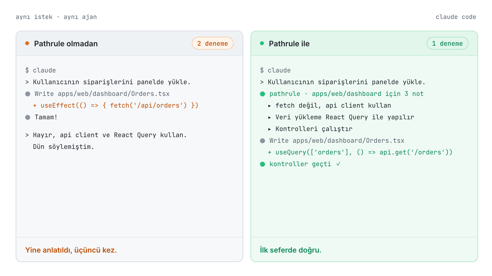
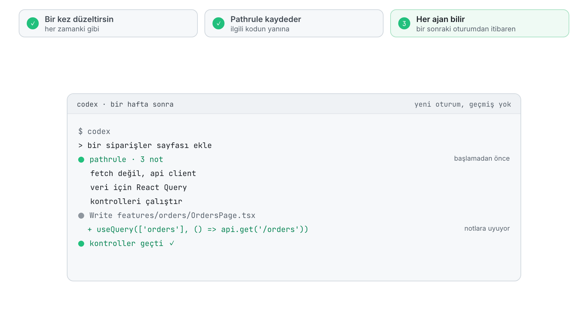
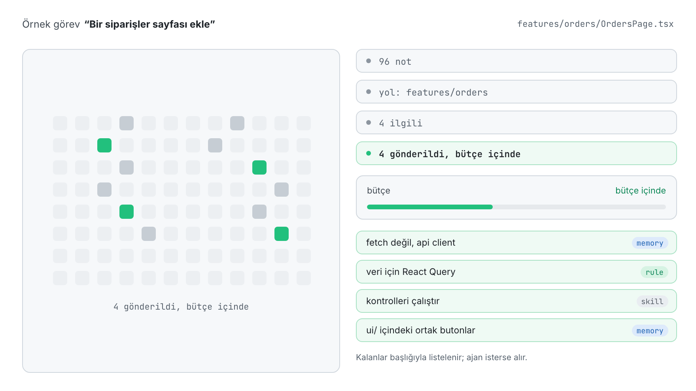
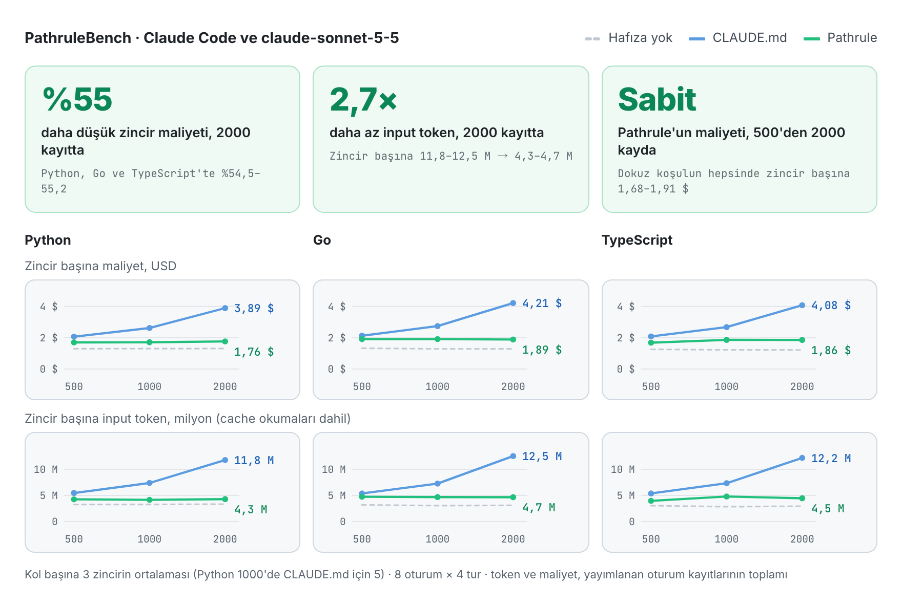
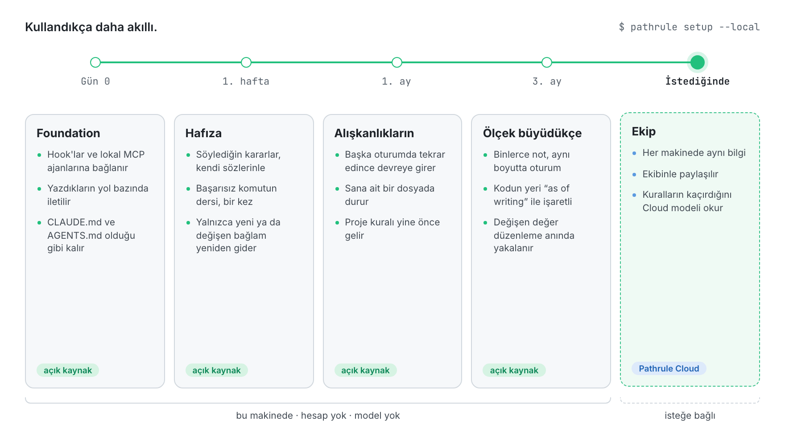
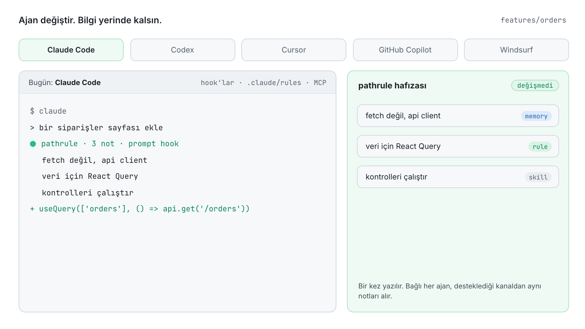

<p align="center">
  <picture>
    <source media="(prefers-color-scheme: dark)" srcset="docs/assets/pathrule-banner-dark.png">
    
  </picture>
</p>

<p align="center">
  <a href="README.md">English</a> · <a href="README.es.md">Español</a> · <a href="README.fr.md">Français</a> · <a href="README.de.md">Deutsch</a> · <a href="README.ja.md">日本語</a> · <a href="README.it.md">Italiano</a> · <b>Türkçe</b> · <a href="README.pt-BR.md">Português (Brasil)</a>
</p>

<p align="center"><sub>Bu çeviri <a href="README.md">İngilizce README</a>'nin gerisinde kalabilir.</sub></p>

<h3 align="center">Yapay zekân unutur. Pathrule hatırlar.</h3>

<p align="center">
  Kodlama ajanları için açık kaynak bilgi katmanı. Pathrule, projenin öğrendiklerini kodundaki yollara bağlı hafıza kayıtları, kurallar ve yetenekler olarak saklar. Claude Code, Codex, Cursor, GitHub Copilot ve Windsurf'e de, harekete geçmeden önce, yalnızca önlerindeki görevin ihtiyaç duyduğunu verir.
</p>

<p align="center">
  <a href="https://www.npmjs.com/package/@pathrule/cli"></a>
  <a href="LICENSE"></a>
  <a href="#benchmarks"></a>
  <a href="https://github.com/pathrule/pathrule/actions/workflows/ci.yml"></a>
  <a href="https://marketplace.visualstudio.com/items?itemName=Pathrule.pathrule-vscode"></a>
  <a href="https://open-vsx.org/extension/Pathrule/pathrule-vscode"></a>
</p>

<p align="center">
  <b>PathruleBench, 2000 kayıt:</b> zincir başına %55 daha düşük maliyet · 2,7× daha az input token · hafıza testlerinin %97'si geçildi · <a href="#benchmarks">rakamlar</a>
</p>

<p align="center">
  <a href="https://www.pathrule.io">Web sitesi</a> · <a href="https://www.pathrule.io/docs/start/quickstart">Dokümantasyon</a> · <a href="#quickstart">Hızlı başlangıç</a> · <a href="#benchmarks">Benchmark</a> · <a href="#local-first">Zamanla daha akıllı</a> · <a href="https://www.pathrule.io/changelog">Değişiklik günlüğü</a>
</p>

<p align="center">
  <picture>
    <source media="(prefers-color-scheme: dark)" srcset="docs/assets/readme/tr/hero-dark.gif">
    
  </picture>
</p>

<p align="center"><sub><i>Aynı istek, aynı ajan. Sağda, ajan tek satır yazmadan önce Pathrule'un hook'u <code>apps/web/dashboard</code> için kaydedilmiş üç notu iletiyor.</i></sub></p>

<p align="center">
  <b>Şunlarla çalışır</b>  Claude Code · Codex · Cursor · GitHub Copilot · Windsurf · herhangi bir MCP istemcisi
</p>

<a id="quickstart"></a>

## Hızlı başlangıç

Node.js 22.14.0 veya üstü; macOS, Linux ya da Windows.

```bash
npm i -g @pathrule/cli
pathrule setup --local    # hesap yok: bilgi bu makinede kalır
pathrule doctor           # her ajanın ne aldığını gör
```

Ajanını yeniden başlat. Bir sonraki oturumdan itibaren, dokunmak üzere olduğu yolun notlarını alır ve çalışırken yenilerini yazar.

| Diğer başlangıç yolları | Komut | Ne için uygun |
| --- | --- | --- |
| VS Code eklentisi | `code --install-extension Pathrule.pathrule-vscode` | Bilgi, kodun hemen yanında. Marketplace ve Open VSX. |
| Claude Code / Codex plugin'i | `/plugin marketplace add pathrule/pathrule` · `codex plugin marketplace add pathrule/pathrule` | Ajanın içinden kurmak için. Kurulum bir şey değiştirmeden önce planı gösterir. |
| Cursor plugin'i | Cursor Marketplace → Pathrule | Cursor içinde aynı hook'lar, MCP ve skill'ler. |
| Gemini CLI / OpenCode plugin'i | `gemini extensions install https://github.com/pathrule/gemini-cli-extension` · `opencode plugin @pathrule/opencode --global` | Gemini CLI ve OpenCode'da aynı kurulum. |
| Herhangi bir MCP istemcisi | `npx -y @pathrule/mcp` | Plugin sistemi olmayan ajanlar için. Resmî MCP Registry'de listeli. |
| Local Console | `pathrule ui` | Bilgiyi 127.0.0.1 üzerinde gez ve düzenle. Hesap gerekmez. |
| Remote MCP | `claude mcp add --transport http pathrule https://cloud.pathrule.io/mcp` | Hiçbir şey kurmadan denemek için. Hook ve lokal mod yok. |
| Kaynak koddan | `pnpm install && pnpm cli:bundle` | Pathrule'a katkı vermek için. [docs/quickstart.md](docs/quickstart.md) dosyasına bak. |

<a id="explain-once"></a>

## Bir kez anlat

Kodlama ajanları her oturuma sıfırdan başlar. Bu yüzden aynı düzeltme gün be gün, ajan ajan geri gelir:

| Gün | Ajan | Yazdığın |  |
| --- | --- | --- | --- |
| Pzt | Claude Code | “fetch değil, bizim api client'ı kullan” | 1. |
| Sal | Claude Code | “yine söylüyorum: api client, fetch değil” | 2. |
| Çar | Codex | “biz api client kullanıyoruz.” | 3. |
| Per | Cursor | “Dün söyledim. api client.” | 4. |
| Cum | Claude Code | “API CLIENT. FETCH DEĞİL.” | 5. |

Beş oturum, üç ajan, akılda kalan hiçbir şey. Pathrule ile bir kez söylersin:

<p align="center">
  <picture>
    <source media="(prefers-color-scheme: dark)" srcset="docs/assets/readme/tr/explain-once-dark.gif">
    
  </picture>
</p>

1. **Bir kez düzeltirsin**, her zaman yaptığın gibi.
2. **Pathrule kaydeder**, ilgili kodun hemen yanına: her oturumun okumak zorunda olduğu bir dosyaya eklenen bir satır olarak değil, `features/` üzerinde bir hafıza kaydı olarak.
3. **Her ajan bilir**, bir sonraki oturumdan itibaren, hangisini açarsan aç.

<a id="how-it-works"></a>

## Yalnızca gerekenler

Bir çalışma alanında yüzlerce not birikir. `features/orders` üzerinde çalışan bir ajanın bunlardan dördüne ihtiyacı vardır.

<p align="center">
  <picture>
    <source media="(prefers-color-scheme: dark)" srcset="docs/assets/readme/tr/only-what-matters-dark.gif">
    
  </picture>
</p>

Bilgi yol, kapsam ve ilgiye göre seçilir, sonra prompt başına bir bütçeye sığdırılır. Zorunlu kurallar yer açmak için asla kesilmez. Sığmayanlar başlığıyla listelenir; ajan isterse alabilir. Bir prompt bir fonksiyonun ya da tipin adını andığında hook, ajana onun tanımlandığı dosyayı ve satırı da gösterir (JS/TS, Python, Go).

### Üç tür bilgi

| Tür | Ne içerir | `features/` üzerindeki örnek |
| --- | --- | --- |
| **Hafıza** | Kararlar, tuzaklar ve olaylar; kısa markdown olarak. | “api client kullan. Kimlik doğrulamayı ve yeniden denemeleri o halleder.” |
| **Kural** | Ajanın uyması gereken kısıtlar; tavsiyelerin üstünde yer alır. | “Veri yükleme React Query üzerinden yapılır.” |
| **Yetenek** | Bir ajanın çalıştırabileceği, yeniden kullanılabilir prosedürler ve kontrol listeleri. | “Bitti demeden önce kontrolleri çalıştır.” |

### Üç giriş yolu

| Kanal | Ajana ne zaman ulaşır | Maliyet |
| --- | --- | --- |
| Yola bağlı kural dosyaları | Claude Code oturum başında Pathrule'un kendi `.claude/rules/pathrule/` klasörünü okur; her dosya kendi yollarına bağlıdır. `CLAUDE.md` ve `AGENTS.md` dosyaların olduğu gibi kalır. | İstemci önbelleğe alır. |
| Hook'lar | Ajan harekete geçmeden önce: oturum başında, her prompt'ta ve dosya araçlarında. Yalnızca yeni ya da değişen bağlam yeniden gönderilir. | Prompt başına bütçeli. |
| MCP `get_context` | Ajan istediğinde, isteğin gerektirdiği derinlikte. | Her MCP istemcisinde var. |

<a id="benchmarks"></a>

## Neden sadece CLAUDE.md değil?

<a href="https://github.com/pathrule/benchmark"></a>

**Bir CLAUDE.md dosyası her adımda baştan sona okunur; ekibinin eklediği her not, her oturumu daha pahalı hâle getirir. Pathrule her prompt'a yalnızca yolun ve görevin ihtiyacı olanı gönderir.** PathruleBench bu farkı aynı ajan, aynı prompt'lar ve aynı gizli kontrollerle, 500'den 2000 kayda kadar ekip bilgisiyle ölçtü.

<p align="center">
  <picture>
    <source media="(prefers-color-scheme: dark)" srcset="docs/assets/readme/tr/bench-cost-tokens-dark.png">
    
  </picture>
</p>

<div align="center">

| 2000 kayıtlık ekip bilgisinde | CLAUDE.md | Pathrule |
| :-- | :-: | :-: |
| 8 oturumluk zincirin maliyeti | 3,89–4,21 $ | **1,76–1,89 $** |
| Zincir başına input token | 11,8–12,5 M | **4,3–4,7 M** |
| Geçilen hafıza testleri | %89 | **%97** |
| Her hafıza testini geçen zincir | 9'da 0 | **9'da 5** |
| Bir kez söylenen alışkanlığa sonra uyulması | %78 | **%97** |
| Başarısız bir komutun öğrettiğinin akılda kalması | %33 | **%78** |
| Her prompt'un istediği iş | %100 | **%100** |

</div>

500'den 2000 kayda çıkınca CLAUDE.md ile bir zincir %89–98 daha pahalıya geliyor. Pathrule ile değişim −%1 ile +%10 arasında kalıyor. Bilgi tabanın büyüyebilir; fatura büyümez.

<sub>Python, Go ve TypeScript'te claude-sonnet-5-5 ile Claude Code; 2000 kayıtta kol başına dokuz zincir (her dilde üç); her geçişe çalıştırılabilir testler karar verir, hiçbir şeyi bir model değerlendirmez. Pathrule kolu, bu repository'nin lokal modda açık kaynak CLI'ıdır: Cloud yok, model yok.</sub>

**[Her koşul, zincir ve kontrol, kendin çalıştırma adımlarıyla → pathrule/benchmark](https://github.com/pathrule/benchmark)**

<a id="local-first"></a>

## Kullandıkça daha akıllı.

İlk gün ne hesap ne ağ ne de model gerekir. Sonrasındaki her şey, senin ve ajanlarının bu repository'de zaten yaptıklarının üzerine kurulur.

<p align="center">
  <picture>
    <source media="(prefers-color-scheme: dark)" srcset="docs/assets/readme/tr/over-time-dark.gif">
    
  </picture>
</p>

| Ne zaman | Pathrule ne yapar | Nerede çalışır |
| --- | --- | --- |
| **Gün 0**<br>Foundation | Hook'lar ve lokal MCP sunucusu ajanlarına bağlanır. Yazdıkların yol bazında, bir bütçe içinde, hook'lar ve Claude Code'un yola bağlı kurallarıyla iletilir; kendi `CLAUDE.md` ve `AGENTS.md` dosyaların olduğu gibi kalır. | Açık kaynak, bu makine |
| **1. hafta**<br>Hafıza | Bir prompt'ta söylediğin karar (“bundan sonra…”, “şuna karar verdik…”) kendi sözlerinle kaydedilir. Başarısız bir komutun öğrettiği ders bir kez kaydedilir. Her not ilgili kodun yanına kaydedilir; yalnızca yeni ya da değişen bağlam yeniden gönderilir. | Açık kaynak, bu makine |
| **1. ay**<br>Alışkanlıkların | Söylediğin bir tercih, sana ait lokal bir dosyada durur. Çalışırken bir kez söylenirse bekler; başka bir oturumda yeniden söylenirse her ajana ulaşır. Kalıcı olduğunu söylediğin tercih hemen geçerli olur. Proje kuralı her zaman kişisel tercihin önüne geçer. | Açık kaynak, bu makine |
| **3. ay**<br>Ölçek büyüdükçe | Binlerce not olsa da oturumun boyutu değişmez: kök kural dosyası 6000 karakter civarında kalır, gerisi prompt başına gelir. Kodun nerede durduğunu söyleyen bir cümle `(as of writing)` ile işaretlenir; bir ekip arkadaşın dosyayı taşıdığında ajan kodu takip eder. Bir düzenleme, daha yeni bir kararın yerini aldığı bir değeri yazdığında hook o kararı tam o düzenlemede hatırlatır. | Açık kaynak, bu makine |
| **İstediğinde**<br>Ekip | Aynı bilgi her makinede ve her ekip üyesinde. Bir Cloud çalışma alanında, Pathrule'un cümle kurallarının hiçbir şey bulamadığı prompt'ları bir model de okur ve kalıcı olmasını istediğin cümleyi senin sözlerinle saklar. Ücreti AI Credits'ten ödenir. | Pathrule Cloud, isteğe bağlı |

<sub>Makinende hiçbir model çalışmaz. Ekip aşamasından önceki her şey açık kaynak CLI'dır; yukarıdaki benchmark'ın ölçtüğü yolun ta kendisi.</sub>

<a id="agents"></a>

## Ajan değiştir. Bilgi yerinde kalsın.

<p align="center">
  <picture>
    <source media="(prefers-color-scheme: dark)" srcset="docs/assets/readme/tr/any-agent-dark.gif">
    
  </picture>
</p>

| Ajan | Harekete geçmeden önce | Talimat dosyası | MCP |
| --- | --- | --- | --- |
| Claude Code | Hook'lar, prompt hook'u dahil | Pathrule'un kendi `.claude/rules/pathrule/` klasörü | Lokal ya da uzak |
| Codex | Hook'lar, prompt hook'u dahil | — | Lokal ya da uzak |
| Cursor | — | — | Lokal |
| GitHub Copilot | — | — | Lokal |
| Windsurf | — | — | Lokal |
| Herhangi bir MCP istemcisi | — | — | Lokal ya da uzak |

<a id="vs-rules-files"></a>

## Bir kural dosyası daha değil

|  | Bir kural dosyası | Pathrule |
| --- | --- | --- |
| Yazılış | Elle yazılır, elle güncel tutulur | Sen ve ajanların çalıştıkça büyür |
| Ulaştığı yer | Dosya başına bir araç | Bağlı her ajan |
| İletim | Her oturumda, tamamı | Yalnızca yolun ve görevin ihtiyacı kadar |
| Değişim | Biri düzenlediğinde | Sürümlenir; yeni bilgi eskisinin yerini alır |

`CLAUDE.md` ve `AGENTS.md` dosyalarını koru: Pathrule onlara dokunmaz. Gerisini, tek bir dosyanın ulaşamadığı yerlere yol ve görev bazında iletir.

<a id="repository"></a>

## Bu repository'de neler var

Burası Pathrule'un açık kaynak temeli. Hesap ve ağ servisi olmadan çalışır: depo, arama ve sıralama, MCP sunucusu, hook'lar, öğrenme döngüsü ve CLI.

| Parça | Burada | Lisans |
| --- | --- | --- |
| **Foundation**: protokol, agent IR, lokal bilgi deposu, host, MCP sunucusu, CLI, Pathrule Cloud istemcisi, ajan entegrasyonları, Local Console, VS Code eklentisi | Evet | Apache-2.0 |
| **Pathrule Cloud**: ekip çalışma alanları, senkronizasyon, web konsolu, Remote MCP, Cloud'un model katmanı | Hayır | Kapalı kaynak |

<details>
<summary><b>11 paket</b></summary>

[`protocol`](packages/protocol) · [`agent-ir`](packages/agent-ir) · [`core`](packages/core) · [`integrations`](packages/integrations) · [`mcp`](packages/mcp) · [`host`](packages/host) · [`ui`](packages/ui) · [`local-console`](packages/local-console) · [`cloud`](packages/cloud) · [`cli`](packages/cli) · [`vscode`](packages/vscode)

</details>

```bash
pnpm install
pnpm typecheck      # tüm paketler
pnpm test           # her paketin testleri
pnpm build          # her paketin npm build'i
```

<a id="privacy"></a>

## Kodun sende kalır

- Kaynak kod asla otomatik olarak yüklenmez.
- Lokal mod hesap gerektirmez, model çalıştırmaz ve açık CLI telemetri göndermez.
- Ajanın kendi model sağlayıcısını kullanmaya devam eder. Pathrule bir model, ajan ya da IDE değildir.
- Pathrule Cloud isteğe bağlıdır. Oturum açtığında bilgini saklar ve sıralamak için prompt'u kullanır; model katmanı da kalıcı olması istenen bir kararı bulmak için bir prompt'u okuyabilir.

<a id="community"></a>

## Topluluk

<a href="https://star-history.com/#pathrule/pathrule&Date">
  <picture>
    <source media="(prefers-color-scheme: dark)" srcset="https://api.star-history.com/svg?repos=pathrule/pathrule&type=Date&theme=dark">
    
  </picture>
</a>

### Katkıda bulunanlar

<a href="https://github.com/pathrule/pathrule/graphs/contributors">
  
</a>

[Katkıda bulun](CONTRIBUTING.md) (DCO imzası) · [Davranış kuralları](CODE_OF_CONDUCT.md) · [Güvenlik açığı bildir](SECURITY.md) · [Yardım al](SUPPORT.md) · [Marka politikası](TRADEMARKS.md)

<a id="license"></a>

## Lisans

Apache-2.0. [LICENSE](LICENSE) ve [NOTICE](NOTICE) dosyalarına bak. Pathrule adı ve logosu Apache-2.0 kapsamında lisanslanmamıştır.

<p align="center">
  <a href="https://www.pathrule.io">pathrule.io</a> · <a href="https://www.pathrule.io/docs">Dokümantasyon</a> · <a href="https://www.pathrule.io/products/cloud">Pathrule Cloud</a>
</p>
